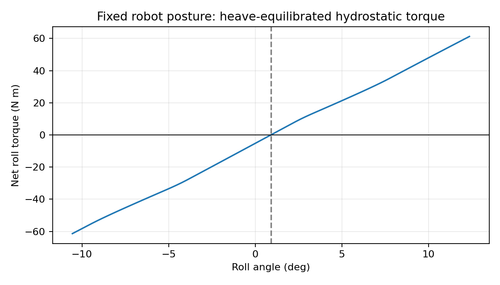

# 流体作用力模型：理论核心、适用条件与验证边界

2026-10-24。本文件取代此前报告中关于“推荐模型组合”的表述；历史实验数据、拟合结果和图保持可追溯。所有工作位于本独立研究副本，未更改机器人、船、桨的 XML/STL。

## 1. 本轮结论与实际完成范围

采用“统一力学核心 + 有界实验参考 + 明确未闭合项”的结构。优先使用 JFM/PRL 的理论机制，同时保留直接针对赛艇的专业期刊实验；期刊级别不能替代几何、自由液面、运动及雷诺数条件匹配。

已实现：六维力/力矩参考点变换；固定几何无界势流的完整附加惯性核；包含平动-转动耦合的 MuJoCo 隐式联立；零航速线性辐射阻尼到记忆核的数值变换；严格限定的经验参考入口；力项重叠检查；现有 CAD 的升沉-横倾-纵倾平衡和静稳定性分析；工况等权的误差复核。

没有把这些内核描述为已经标定完成的当前 CAD 船桨模型。任意近水面周期划桨的分离、通气、尾涡再遇和入出水仍缺乏统一闭合；未知作用不是零作用。缺乏相应数据时，不应用附加的任意阻尼、增益或浸深因子掩盖。

## 2. 从应力积分出发，而不是从经验力清单出发

水为不可压缩牛顿流体：

\[
\nabla\cdot\mathbf u=0,\qquad
\rho(\partial_t\mathbf u+\mathbf u\cdot\nabla\mathbf u)
=-\nabla p+\mu\nabla^2\mathbf u+\rho\mathbf g.
\]

以物体外法向（指向水域）为 \(\mathbf n\)，实际流体牵引为

\[
\mathbf t=(-p\mathbf I+2\mu\mathbf D)\mathbf n,
\quad \mathbf D=(\nabla\mathbf u+\nabla\mathbf u^T)/2.
\]

\[
\mathbf F=\int_{S_w}\mathbf t\,dS,\qquad
\mathbf M_O=\int_{S_w}(\mathbf r-\mathbf r_O)\times\mathbf t\,dS.
\]

完整问题还包括物体运动边界、自由液面运动学与应力条件以及远场/水池边界。静水面裁切仅求几何浸没，不等于求解动态液面、通气空腔或湿润接触线。

Graham (JFM 2019) 从压力控制方程讨论加速、对流与黏性贡献，说明“无旋/有旋速度分解”不意味着相应力项可互不耦合地独立拟合；黏性影响也包含压力贡献，不能全部等同于表面摩擦。该文的无界流体推导不是现成的自由液面划桨定律。[Graham2019]

本模型采用以下记账定义：

\[
\mathcal W=\mathcal W_{HS}+\mathcal W_{P}+\mathcal W_{R},\qquad
\mathcal W_R:=\mathcal W_{\rm actual}-\mathcal W_{HS}-\mathcal W_P.
\]

这是明确残差的定义，不是声称势流、涡、自由液面和黏性可以不经联合标定而独立相加。对包含全部动态影响的 Barré 经验力，直接采用其总动态闭合，不再添加 \(\mathcal W_P\) 或另一套历史力。

## 3. 保留的力学核心

### 3.1 几何静水力

\[
p_{HS}=\rho g(z_w-z),\quad
\mathbf F_{HS}=-\int_{S_w}p_{HS}\mathbf n\,dS,
\quad\mathbf M_{HS,O}=-\int_{S_w}(\mathbf r-\mathbf r_O)\times p_{HS}\mathbf n\,dS.
\]

保留湿三角面的压力和力矩积分。适用于静水基准下的瞬时几何静水项；动态压力另计。该项已包含姿态相关恢复力，不另加静水恢复弹簧。几何必须有正确朝向并封闭排水体积；多个组件的重叠体积不能重复计算。

原实现通过解析箱体的阿基米德浮力及力矩测试。当前 CAD 尚存在组件重叠没有布尔并集、轴与尾鳍排水体积未全部包含的限制，因此对实物的静稳定性结论仍需几何核验。

### 3.2 六维力与力矩接口

统一采用 \(\nu=[\mathbf v,\boldsymbol\omega]\)、\(\mathcal W=[\mathbf F,\mathbf M]\)。同一坐标系下 \(\mathbf r=\overrightarrow{OP}\)：

\[
\nu_P=\mathbf X\nu_O,\quad
\mathbf X=\begin{bmatrix}\mathbf I&-[\mathbf r]_\times\\0&\mathbf I\end{bmatrix},
\quad \mathcal W_O=\mathbf X^T\mathcal W_P.
\]

由此自动保持功率 \(\mathcal W_O^T\nu_O=\mathcal W_P^T\nu_P\)。本征力矩和 \(\mathbf r\times\mathbf F\) 不得重复添加。关节广义力为 \(\mathbf J_O^T\mathcal W_O\)，雅可比必须对应同一参考点。

### 3.3 固定几何的势流附加惯性

对无界、不可压缩、无黏、无旋、无环量流体，固定完全浸湿的刚性物体可用六个单位运动势：

\[
\nabla^2\phi_i=0,\qquad
\partial_n\phi_i=\mathbf n\cdot\mathbf V_i,
\qquad \phi_i\to0\quad(r\to\infty),
\]

\[
A_{ij}=\rho\int_{V_f}\nabla\phi_i\cdot\nabla\phi_j\,dV,
\qquad T_A=\tfrac12\nu^T\mathbf A\nu.
\]

\(\mathbf A\) 对称、半正定，包含平动、转动及其耦合块。不能把不同块不经单位处理直接比较数值大小。[Graham2019, Fossen]

设 \([\mathbf p_A,\mathbf h_A]^T=\mathbf A\nu\)，作用在物体上的势流惯性力为

\[
\mathcal W_P=-\mathbf A\dot\nu-
\begin{bmatrix}
\boldsymbol\omega\times\mathbf p_A\\
\mathbf v\times\mathbf p_A+\boldsymbol\omega\times\mathbf h_A
\end{bmatrix}.
\]

点号是体坐标分量导数。均匀稳恒来流下：

\[
\dot{\mathbf v}_{r,b}=\mathbf R^T\mathbf a_{r,w}-\boldsymbol\omega_b\times\mathbf v_{r,b}.
\]

能量关系为 \(\mathcal W_P^T\nu=-dT_A/dt\)。球体的平动附加质量为排水质量的一半，绕球心转动的势流附加惯性为零，作为独立解析基准。

**适用限制：** 新类名为 `UnboundedPotentialInertia`。它不接受“近水面等效质量”的自动宣称；当前没有给实际桨叶填入未经求解的六维矩阵。无界矩阵不能直接视为自由液面辐射的高频附加质量，更不能用湿面积比例缩放后仍声称能量恒等式成立。变湿面积需要额外的动量通量和入水理论。

MuJoCo 联立求解使用

\[
\mathbf w+\mathbf A(\mathbf B\ddot{\mathbf q}(\mathbf w)+\mathbf b)=0.
\]

其中 \(\mathbf B\) 映射到一致的流体坐标，\(\mathbf b\) 包含雅可比导数与体坐标导数修正；对流项已放在基准外力中。保留刚体约束的同时求解，避免上一时刻加速度反馈。该数值接口不会自行生成缺失的流体系数。

## 4. 船体：先识别阻力，再决定是否需要动态兴波

### 4.1 稳态阻力参考

\[
R=\tfrac12\rho S_w U^2[(1+k)C_F(Re)+C_R(Fn)],
\quad C_F=\frac{0.075}{(\log_{10}Re-2)^2}.
\]

ITTC-1957 是成熟的湍流摩擦关联式，而非精确的 Navier-Stokes 解析解。\(k\) 是形状影响的经验表示。Day 数据反推的 \(C_R\) 为剩余阻力，包含多种贡献，不能识别为纯兴波项。[Day2011]

严格入口 `DayReferenceResistance` 只允许原实验船型、长 7.937 m、湿面积 2.34 m²、稳态正向拖曳及原 \(Fn\) 范围；零速由物理极限返回零。源数据支持 \(Fn=0.210466\ldots0.453788\)。低速外推、高速系数钳位、任意船型迁移均不属于该入口。

当前 CAD 按约 5.87766 m 湿润长度换算，同一 Fn 区间对应约 1.59816–3.44580 m/s。此换算仅作范围筛查，不证明几何相似。目标艇需自行建立 \(R(U,z,\theta)\) 数据。

如果保留包含兴波贡献的总经验船阻，不能再加完整稳态兴波力。若未来采用“黏性项 + 理论兴波项”，须重新识别非兴波残差；若加动态修正，须与原稳态兴波基准一致并显式扣除重叠部分。

### 4.2 线性波辐射：保留理论，不捏造系数

在零航速、固定平均湿表面、小幅运动、线性自由液面条件下，Cummins 形式为

\[
\mathcal W_{rad}(t)=-\mathbf A_\infty\dot\nu(t)
-\int_0^t\mathbf K(t-s)\nu(s)\,ds,
\quad
\mathbf K(t)=\frac2\pi\int_0^\infty\mathbf B(\omega)\cos\omega t\,d\omega.
\]

\(\mathbf A_\infty,\mathbf B(\omega)\) 应来自同一个线性水动力边值问题。辐射阻尼在该零航速条件下应满足互易性和非负耗散；有限三维物体的零频辐射阻尼应为零，稳态黏性阻尼另计。有限频率数据仍需检查截断、步长和因果一致性。[Cummins1962, PerezFossen2008]

新增 `cummins_kernel` 只实现这个有明确输入的变换，不为实际船体指定任何数值。它允许变号、振荡的记忆核；只有正权衰减指数的模型会漏掉部分合法响应。使用正实传递函数 \(Z(s)=bs/(s^2+2\lambda s+\omega_0^2)\) 对应的解析阻尼谱与振荡核验证变换；其零频阻尼为零。这个解析例子用于验证算法，不代表某艘船的系数。

零均值周期扰动在常系数线性记忆模型中产生零均值记忆力。因此，平均兴波增量不能仅靠线性记忆核解释。非零平均修正可能来自瞬时稳态力的非线性平均，也可能来自二阶动态效应，二者必须分开。

对有明显前进速度的赛艇，不能把零航速 Cummins 模型直接搬过来。需要围绕给定前进速度的边值问题及对流自由液面条件，或明确使用移动压力模型的近似。

### 4.3 Dode JFM 2022：先做无量纲筛查

Dode 采用线性小扰动、深水、给定 Lorentzian 移动压力分布，研究周期变速的平均兴波阻力；其结论是定性地解释实验趋势，不是任意 CAD 船型的高精度闭合。[Dode2022]

定义

\[
Fn=\frac{U_0}{\sqrt{gL}},\quad
\widetilde\Omega=2\pi f\sqrt{L/g},\quad
Fn\widetilde\Omega=\frac{2\pi fU_0}{g}.
\]

理想模型的 Wehausen 共振条件为 \(Fn\widetilde\Omega=1/4\)，即
\(f_r=g/(8\pi U_0)\)。例如 U=4 m/s、f=0.5 Hz 时该乘积约 1.281，\(f_r\approx0.0976\) Hz。这是一个假设工况，不是机器人实测值。

论文讨论指出，其所考察的赛艇竞赛速度/频率区域没有显著平均非定常兴波效应。不能将其推广为船体没有兴波、瞬时波力为零或所有低速启停也适用；也不应反过来声称所有划船必须加入很强的兴波记忆。已有实现与论文理论曲线的差异尚未解决，所以公式实现和拟合响应表均保留为研究基准，不进入推荐定量核心。

## 5. 桨叶：保留有条件的三种参考，不强行拼合

### 5.1 准定常参考

\[
\mathbf F_{QS}=\tfrac12\rho U_r^2 A[-C_D\mathbf e_v+C_L\mathbf e_L].
\]

Grift2019 深度系数只用于 0.20 × 0.10 m 矩形平板、0.30 m/s、稳态法向平移、上缘浸深 0–0.20 m 的已比较数据。不同速度与浸深的联合系数表尚未识别。[Grift2019]

Caplan2007 极线只用于其四分之一尺度平面 Big-Blade 外形、面积 0.007742 m²、0.75 m/s、上缘在静水面、无跨展流的静态条件。新入口输出实验定义下的阻力/升力，**不凭空输出压力中心或桨轴力矩**。[Caplan2007]

二者是不同条件下的替代参考；不得乘叠。对旋转的实际桨叶，把整块桨的极线分配给多个局部条带属于额外近似，需独立验证，而不是文献已经证明。

### 5.2 起动历史力：PRL/JFM 理论的专门用途

Reijtenbagh2023 (PRL) 指出法向起动平板的力不能普遍用固定附加质量乘加速度概括；2026 JFM 给出运动历史模型及更完整的实验。[Reijtenbagh2023, Reijtenbagh2026]

\[
F_D=F_{QS}+F_{ex},\qquad
F_{ex}=\tfrac12 C_0\rho A\sqrt{\nu Re_a}
\int_0^t\frac{a(s)}{\sqrt{t-s}}\,ds,\qquad C_0=1.5.
\]

这里 \(Re_a\) 和特征长度的定义必须与运动族一致。恒加加速度和平方根速度不能随意沿用恒加速度的参数定义。该式是规定起动运动的闭合，不是任意变号加速度的通用卷积模型。

严格接口当前只覆盖已比较的 0.20 × 0.10 m 参考板、上缘深 0.15 m、最终速度 0.60 m/s、恒加加速度 J=0.1–0.8 m/s³ 或平方根速度参数 Q²=0.16–0.64 m²/s³。用户还须明确确认静水起动、固定浸深、直线法向运动及可忽略自由液面耦合的假设；这些声明不是自动实验认证。

该超额力替代完整的动态超额闭合，不再加一遍完整潜流附加质量。跨实验迁移的结果并不支持把它提升为普适划桨力模型。旋转、反向、近水面通气、尾涡再遇均超出当前验证域。

### 5.3 规定划程动态经验参考

Barré/Leroyer 的矩形桨、固定浸深、\(\dot\theta=K\sin\theta\) 规定运动仍保留。它与实际赛艇有关联，且整划程实验中通常优于直接迁移静态极线，因此不因期刊级别低于 JFM 而删除。[Barre2010, Leroyer2008, Leroyer2010]

已有 `PrescribedTankStroke` 对原始 K 和约化频率支持域做检查。几何缩放只是相似性假设；完整 Froude 相似与 Reynolds 相似不能在同种流体的任意尺度变化下同时保持。该模型已综合动态与自由液面影响，不加另一套附加质量、历史或深度修正。

压力中心不固定。使用桨面中心只是一种需报告误差的力矩基线；采用四分之一弦长未在新增 Leroyer 工况中改善力矩。

### 5.4 自由液面与尾流的未闭合部分

Leroyer2010 的深水/近水面、静态/动态对照表明自由液面修正甚至可以改变符号。不能写成通用的 \(C_D(\alpha)\times f(h/c)\times g(\dot\alpha)\)。[Leroyer2010]

后续需要同一几何、同一工况定义下联合测得或计算
\((\mathbf F,\mathbf M)\)，以 \(\alpha,h/c,Re,Fn\)、转动及加速度参数、有效湿润/通气状态和尾流历史为输入。用同一组基准扣除已知部分后再识别残差。

这是一项尚未完成的数据与建模任务。当前没有把它用零力、任意增益、固定压力中心或未经标定的状态方程替代。

## 6. 明确退出推荐核心的部分

| 旧部分 | 处理 | 原因 |
|---|---|---|
| Grift 起动增长与经验衰减尾项 | 历史比较保留；不进入推荐核心 | 单工况拟合；尾项不是通用文献公式 |
| 自拟尾流动量模型及大升阻增益 | 研究候选 | 安装角迁移和部分划程恶化，参数存在代偿 |
| 环量滞后拟合 | 研究候选 | 当前最优滞后为零，无增加复杂度的证据 |
| 固定 0.84 矩形板质量直接迁移 CAD | 研究候选 | 展弦比、方向、自由液面与湿面积变化不匹配 |
| 船体/鳍 Cd=1 横向阻尼 | 未标定项 | 没有当前系统实验依据，不能用以宣称平衡可信 |
| Dode 实验响应表 | 数据内插基准 | 船型和 Fn 限制；不是瞬时力理论 |
| 正权单调衰减船体记忆 | 数学候选 | 限制核形状；不能单独产生二阶平均力 |
| 固定四分之一弦长压力中心 | 不作为默认 | 在新增力矩实验中比中心基线更差 |

`validate_components` 拒绝已知的重复贡献和研究候选进入参考组合；它只是组合审查，不是模型完整性或实际船桨适用性的认证。

原 `RowingHydrodynamics` 为保持过去结果可重复仍可调用，但模块说明和场景元数据已明确标记 `exploratory_legacy_scene`、`validated_for_current_CAD=False`。没有悄悄把未建模的横向流体力设为零，也没有继续将这个适配器称为已验证核心。

## 7. 本轮实际验证结果

完整测试结果见 `results/core/verification.json`；原有 20 项之外，新增完整耦合惯性、能量与参考点协变、旋转坐标导数、解析球体、独立刚体+流体质量矩阵求解、振荡记忆核、零频辐射条件、适用域拒绝和重复计入拒绝检查。数值一致性不替代物理实验。

新限定入口复算原留出数据，无参数重拟合：

| 数据 | 留出/比较量 | RMSE | 新旧预测最大差 |
|---|---|---:|---:|
| Day2011 | 6 个留出速度，总阻力 | 0.125679 N | 7.1e-15 N |
| Grift2019 | 60 个留出浸深标记，Cd | 0.035339 | 2.2e-16 |
| Caplan2007 | 17 个留出角度，Cd | 0.030904 | 6.7e-16 |
| Caplan2007 | 17 个留出角度，Cl | 0.023775 | 2.2e-16 |
| Reijtenbagh2026 | 11 工况、4844 个重采样图线值，超额力 | 0.483432 N | 3.2e-14 N |

4844 是评分所用的重采样点数，不是独立实验数。静态内插误差不是任意 CAD 或真实划桨的预测误差。

所有此前真实轨迹误差仍有效，未通过换指标或重拟合消除。例如：Grift2021 在安装角 15° 留出工况中，静态迁移/自拟尾流力 RMSE 为 3.299/4.553 N；Leroyer2010 中段 Barré 模型的推进冲量误差仍为 +20.56%。这正是限制候选模型适用范围的依据。

2026 历史模型迁移到 2019 加速核心段时：合并点 RMSE 从 0.50423 降至 0.35856 N，但工况等权平均 RMSE 从 0.37792 升至 0.43153 N。后续必须同时报告逐工况、工况等权和合并统计。

### 当前 CAD 的新静稳定性结果

固定机器人及桨相对姿态，同时求解净竖直力、横倾力矩、纵倾力矩为零：

- 船原点高度 0.119384717 m；横倾 0.905650°；纵倾 0.002678°。
- 三个残差分别约 -5.36e-11 N、-2.02e-11 N·m、9.08e-13 N·m。
- 升沉恢复刚度约 12415.6 N/m。
- 消去升沉自由度后的转动刚度矩阵约为

\[
\begin{bmatrix}-332.1155&1.4526\\1.4526&27926.8762\end{bmatrix}
\quad(\mathrm{N\,m/rad}).
\]

它有负特征值，表示该模型中的固定姿态平衡局部横摇不稳定。有限差分步长从 1e-5 减到 5e-6 后，完整刚度矩阵最大元素变化仅 2.23e-4（各元素保持各自 SI 单位），不是差分噪声造成的符号。

这是当前几何/质量假设下的计算结论，不是实物测量，也不意味着主动控制不能稳定。普通耗散阻尼不能消除负静态恢复刚度的静不稳定；应核实排水几何和重心，并在后续机器人控制中显式处理横摇平衡。



## 8. 下一阶段的实施顺序与验收条件

1. **实际 CAD 几何与浮态。** 核实组件重叠、轴/鳍体积与质量/重心，重新计算水线、完整平衡和恢复矩阵。先确认静稳定结构，再讨论横摇阻尼。
2. **实际船体稳态阻力。** 覆盖目标速度及合理吃水/纵倾范围；采用网格/时间步收敛的离线自由液面 CFD 或同船型水池实验。不得继续把 Day 曲线直接当作该船标定。
3. **实际桨叶的共同条件数据。** 静态与动态必须共享几何、参考点、面积、浸深和力矩定义。至少包含固定深度平移、规定转动、Grift 类真实轨迹及安装角留出；记录力与力矩，保留同步运动学。
4. **独立确定非环量部分，识别联合残差。** 在明确边界条件的势流/压力问题中求取系数；自由液面及入出水不得套用无界常矩阵。动态残差按统一基准识别，检查跨轨迹性能和参数可辨识性。
5. **按无量纲条件决定船体波记忆。** 保留匹配的稳态部分，再增加有数据支持的相位与二阶修正。零航速线性核不直接覆盖前进中的任意划船运动。
6. **整艇与控制验证。** 依次检查规定运动的力/力矩、冲量/做功/相位，再检查自由航行的速度、功率、横摇，最后做 RL。存在记忆时保持流体状态，并提供观测历史或循环策略。

本轮已经完成第 1 项中的现有几何浮态和刚度计算以及基础接口；几何重建、目标 CAD CFD 系数和完整周期桨叶闭合仍未完成。将这些缺口明确写出，比使用无支持参数填满一套方程更可信。

## 9. 可复现入口

```powershell
python -m pytest -q
python tools/check_core_hydrodynamics.py
```

- `hydrodynamics/core.py`：力矩变换、无界势流惯性、零航速辐射核变换。
- `hydrodynamics/reference_models.py`：限定参考入口与组合检查。
- `hydrodynamics/mujoco_adapter.py`：一般附加惯性联立与明确标记的历史场景适配器。
- `results/core/audit.json`：浮态、刚度、范围筛查与实验复算结果。
- `results/core/reference_revalidation.csv`：参考入口复算。
- `results/core/condition_balanced_metrics.csv`：合并/工况等权误差。
- `results/core/dimensionless_support.csv`：假设速度、划频的无量纲筛查。
- `data/core_model_registry.json`：模型取舍、依据及缺口。

## 10. 文献与获取状态

- [Graham2019] Graham, *Decomposition of the forces on a body moving in an incompressible fluid*, JFM 881, 1097–1122. DOI: https://doi.org/10.1017/jfm.2019.788 。本轮已读作者全文 https://arxiv.org/html/1905.02484v2 ，重点核对压力分解和 §4 惯性张量。不是自由液面闭合。
- [Fossen] 作者官方六自由度动力学说明 https://fossen.biz/html/marineCraftModel.html 。用于核对矩阵形式及能量结构，不替代当前船桨的系数识别。
- [Cummins1962] *The Impulse Response Function and Ship Motions*, DTMB 1661. 官方馆藏 https://dome.mit.edu/handle/1721.3/49049 。作为经典线性辐射框架；本轮未取得该馆藏 PDF，不宣称逐式复现原报告。
- [PerezFossen2008] *Time- vs. Frequency-domain Identification of Parametric Radiation Force Models for Marine Structures at Zero Speed*. https://doi.org/10.4173/mic.2008.1.1 ，期刊全文 https://www.mic-journal.no/PDF/2008/MIC-2008-1-1.pdf 。本轮核对 §2 的 Cummins 表达、频域/时域对应及零航速适用条件。
- [Grift2019] *Drag force on an accelerating submerged plate*, JFM 866, 369–398. https://doi.org/10.1017/jfm.2019.102 。已有全文，本轮复核实验几何与浸深扫描条件。
- [Grift2021] *Hydrodynamics of rowing propulsion*, JFM 918, A29. https://doi.org/10.1017/jfm.2021.318 。已有全文和真实轨迹缩比实验比较；不把自拟尾流模型归为该文原始公式。
- [Reijtenbagh2023] *Drag Force on a Starting Plate Scales with the Square Root of Acceleration*, PRL 130, 174001. https://doi.org/10.1103/PhysRevLett.130.174001 。核实 APS 摘要、作者机构记录及公开索引，全文直接下载仍受限；本轮不以未读的正文增加独立定量验证。
- [Reijtenbagh2026] *Scaling of drag forces on accelerating plates*, JFM 1028, A30. https://doi.org/10.1017/jfm.2025.11107 。已有全文；历史公式实际依据此完整后续论文。
- [Dode2022] *Wave drag during an unsteady motion*, JFM 951, A15. https://doi.org/10.1017/jfm.2022.592 。已有全文，本轮再次核对理论边界与赛艇工况结论。
- [Day2011] *An experimental study of unsteady hydrodynamics of a single scull*. https://doi.org/10.1177/1475090211406775 。已有全文，用于原船型稳态和变速实验。
- [Caplan2007] *A fluid dynamic investigation of the Big Blade and Macon oar blade designs in rowing propulsion*. https://doi.org/10.1080/02640410600809985 。用户提供全文，静态升阻极线。
- [Barre2010] *Comparison between common models of forces on oar blades and forces measured by towing tank tests*. https://doi.org/10.1243/17543371JSET43 。用户提供全文，规定运动动态经验参考。
- [Leroyer2008] *Experimental and numerical investigations of the flow around an oar blade*. https://doi.org/10.1007/s00773-007-0256-7 。已有全文，力/力矩联合验证。
- [Leroyer2010] *Influence of free surface, unsteadiness and viscous effects on oar blade hydrodynamic loads*. https://doi.org/10.1080/02640414.2010.485646 。用户提供全文，自由液面与非定常耦合依据。
