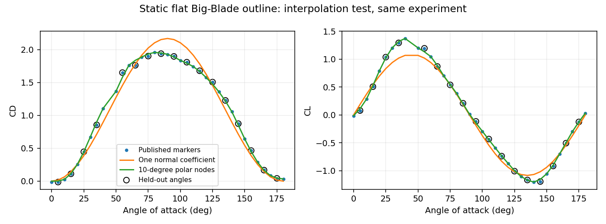
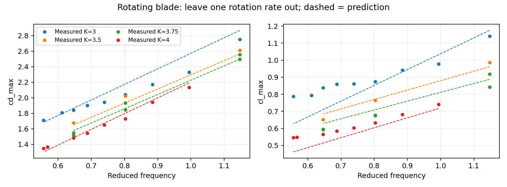
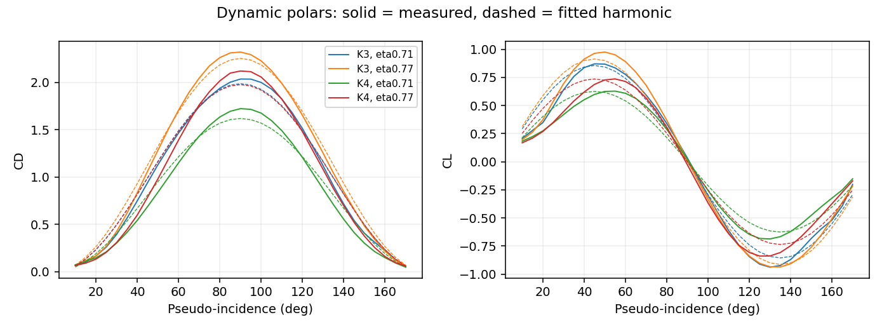
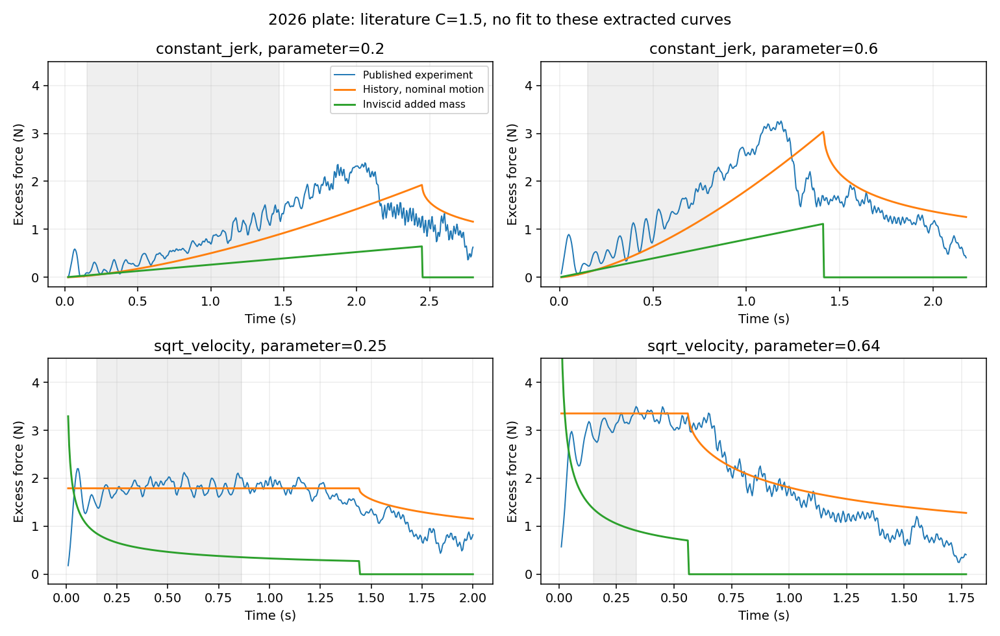
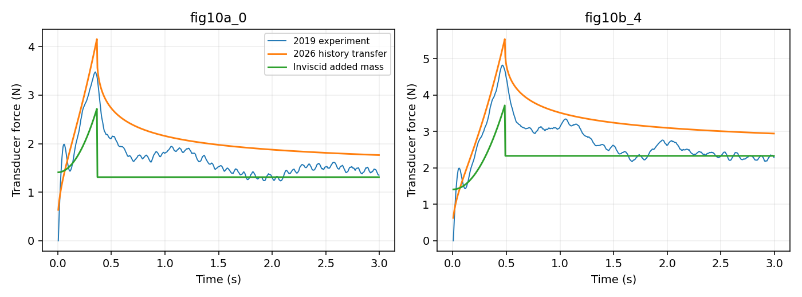
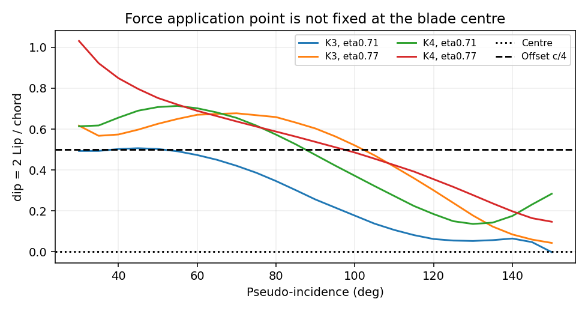

# 划桨水动力扩展研究：全攻角、转动效应、运动历史与验证边界

后续补充已取得 Leroyer 2008/2010 全文，明确外力臂为 1.308 m，并完成两个整划程及桨轴力矩的定量检查。固定四分之一弦长作用点在新工况下并未改善力矩误差；下文结果仅适用于其原有数据与指标。详见 [Leroyer 补充报告](HYDRODYNAMICS_LEROYER_REPORT.md)。

2026-10-24。基于 `kingfloydz/rowing` 提交 `aaa31478ccb7eac62993865e3c4aac64313eeccf`。原始 XML 和几何资产未改动。代码、数据和图位于当前隔离副本，未推送到 GitHub。

本轮新增三篇论文的定量对比，完成五份可追溯数据表、六幅对比图，以及可选的全攻角桨力和旋转附加质量耦合。**结果支持“有实验依据的改进降阶模型”，尚不支持“任意人形机器人划桨动作下的高精度流体求解器”。** 特别是：历史力改善了加速段，却没有改善跨论文完整时程；这一结果没有从报告中删除。

## 1. 文献调研与实际使用情况

| 文献 | 已获取的内容 | 对模型的贡献 | 本轮验证状态 |
|---|---|---|---|
| Caplan & Gardner, 2007, *A fluid dynamic investigation of the Big Blade and Macon oar blade designs in rowing propulsion*, J. Sports Sciences 25(6), 643–650, [DOI](https://doi.org/10.1080/02640410600809985) | 用户提供全文，文件虽名为 `Math_Model_2007_01.pdf`，标题与 DOI 均正确 | 真实桨轮廓的全攻角升阻力；曲率和桨型差异；表面积定义 | 提取 Fig.6 的平面 Big-Blade 轮廓数据，留出攻角测试。弯曲 Big Blade/Macon 数据未混入平板模型 |
| Barré & Kobus, 2010, *Comparison between common models of forces on oar blades and forces measured by towing tank tests*, Proc. IMechE Part P 224, 37–50, [DOI](https://doi.org/10.1243/17543371JSET43) | 用户提供全文 | 转动工况改变升阻力峰值；切向力不可忽略；零力矩作用点移动 | Fig.8 四种工况、Fig.11 四个转速组、Fig.5 作用点；留整组转速测试及作用点近似对比 |
| Day 等, 2011, *An experimental study of unsteady hydrodynamics of a single scull*, [DOI](https://doi.org/10.1177/1475090211406775) | 公开全文，前轮已读 | 单人双桨艇阻力及非定常船体运动 | 原有稳态船阻验证保留，未声称新增船体非定常验证 |
| Grift 等, 2019, *Drag force on an accelerating submerged plate*, JFM 866, 369–398, [DOI](https://doi.org/10.1017/jfm.2019.102) | 公开全文，前轮已提取 | 浸深、附加质量与起动后尾流衰减 | 本轮新增 2026 历史模型向 2019 数据的直接迁移对比 |
| Grift, Tummers & Westerweel, 2021, *Hydrodynamics of rowing propulsion*, JFM 918, A29, [DOI](https://doi.org/10.1017/jfm.2021.318) | 已下载 33 页公开全文 | 半尺度真实桨型沿真实划桨轨迹运动，同时测量法向/切向力与 PIV；是接近划桨应用的重要检验 | 已核对运动缩放与面积定义；本轮未输出该实验的预测误差，不计入已验证数据集 |
| Reijtenbagh, Tummers & Westerweel, 2023, *Drag force on a starting plate scales with the square root of acceleration*, PRL 130, 174001, [DOI](https://doi.org/10.1103/PhysRevLett.130.174001) | 出版信息及 2026 后续论文的引用；原始全文下载受限 | 历史力标度的前期研究 | 不把未读全文当作独立验证；本轮使用已获得的 2026 扩展全文 |
| van Nieuwburg 等, 2023, *Improving rowing performance by adjusting oar blade size and angle*, Frontiers in Sports and Active Living, [DOI](https://doi.org/10.3389/fspor.2023.1109494) | 已下载公开全文 | 1:5 机器人赛艇的整艇周期运动实验，适合后续检验平均船速、功率和周期波动 | 本轮未用不同船体、不同控制的结果来宣称仓库整艇通过验证 |
| Reijtenbagh, Tummers & Westerweel, 2026, *Scaling of drag forces on accelerating plates*, JFM 1028, A30, [DOI](https://doi.org/10.1017/jfm.2025.11107) | 已下载 34 页公开全文；DOI 含 2025，出版年份是 2026 | 统一讨论恒加速度、恒加加速度与平方根速度；附录给出历史积分；明确尾涡脱落后的局限 | 提取 Fig.12(a)、14(a) 共 11 个工况，直接使用文献系数，不按每条力曲线重新拟合 |

补充检索了 Coppel 的 2010 年博士论文 *A Computational Fluid Dynamic Investigation of Rowing Oar Blades*，[伯明翰大学全文](https://etheses.bham.ac.uk/id/eprint/793/1/Coppell10PhD.pdf)。它有助于定位早期实验与 CFD 对比，但本轮有了 Caplan 原文后，定量数据直接来自原文，没有把二手重绘或 CFD 当作新实验。

目前不需要你再找同一批 PDF。更关键的后续资料是作者的**同步运动学与测力原始数据**：例如 2021 年的桨尖轨迹、姿态、升沉与 Fn/Ft，以及 2026 年各工况的实际速度/加速度。公开图线无法完全替代这些数据。

## 2. 数据、标定与评价规则

新增数据均为论文图线数字化，**不是实验原始记录**：

| 数据文件 | 内容 | 提取方法 |
|---|---|---|
| `data/caplan2007_flat_polar.csv` | 36 个角度的 CD、CL | 原始嵌入图像的方形标记中心；45° 两条曲线重合，排除；0°、180° 重合点只作训练边界 |
| `data/barre2010_dynamic_polars.csv` | 四个工况的动态极线，共 1651 个绘图坐标 | PDF 矢量路径；只取右侧攻角图，避免与左侧桨角图重复计数 |
| `data/barre2010_maxima.csv` | 四个转速组的 CDmax、CLmax，共 56 个标记 | PDF 中方形、三角形、菱形、圆形标记对应 K=3、3.5、3.75、4 rad/s |
| `data/barre2010_zero_torque_point.csv` | 四工况的作用点，194 个绘图坐标 | Fig.5 平板右侧图；保存裁切标志 |
| `data/reijtenbagh2026_excess_force.csv` | 6 种恒加加速度、5 种平方根速度，共 18729 个绘图坐标 | 只取彩色实线实验曲线；不把虚线理论结果当成实验；保留曲线段号 |

来源、SHA-256、几何、力的定义、标定和限制见 `data/provenance_extended.json`。绘图坐标数不等于独立样本量或独立实验次数。2026 年图中低于坐标范围的初始力没有被恢复；评分只使用可见曲线区间，不跨越被裁切的空隙补数据。

Caplan 读图误差按 ±2.5 原图像素记录，约为系数 ±0.0233；它不是测量置信区间。因而约 0.024 的 CL 留出误差已接近读图分辨率，不能进一步宣称实物预测具有 3% 精度。

统一报告：

\[
\mathrm{RMSE}=\sqrt{\tfrac1N\sum_i(\hat y_i-y_i)^2},\qquad
\mathrm{NRMSE}_{rms}=\frac{\mathrm{RMSE}}{\sqrt{\tfrac1N\sum_i y_i^2}}.
\]

这个归一化定义与初版报告中的“除以平均力”不同；两版百分数不能直接相减。时程先按固定 0.005 s 网格重采样，避免 PDF 绘图顶点密度影响权重。汇总误差按可见时间长度加权；各工况误差也全部保存在 `results/extended/metrics.csv`。

## 3. 改进模型及其适用范围

船—桨—机器人动力学采用：

\[
M(q)\ddot q+h(q,\dot q)=S^T\tau+J_c^T\lambda+Q_H,
\quad Q_H=\sum_i(J_{p,i}^T F_i+J_{r,i}^T M_i).
\]

船体静水浮力、恢复力矩、ITTC 摩擦阻力与剩余阻力沿用初版。此次改进集中于桨叶，**没有增加未经实验辨识的船体六自由度附加质量矩阵、辐射记忆核或砰击系数**。

### 3.1 静态全攻角升阻力

每个湿润桨片使用其相对水的局部速度，包含船运动、桨转动以及角速度叉乘位置的贡献。将速度投影到桨法向与弦向平面，定义速度大小 U 和攻角 α：

\[
d\mathbf F_{QS}=\tfrac12\rho U^2dA[-C_D(\alpha)\mathbf e_U+C_L(\alpha)\mathbf e_L],
\quad \mathbf e_U\cdot\mathbf e_L=0.
\]

CD、CL 用 Caplan 平面 Big-Blade 轮廓每隔 10° 的训练节点作 PCHIP 插值。留出其余 5° 节点。CD 约束非负，因此阻力耗散，升力不做瞬时平移功。法向坐标翻转不改变计算结果。局部弦向指向桨尖，α<90° 对应桨尖先迎水；反面进流按平板镜像处理，**不是弯曲桨背面已有数据**。

这里的参考面积是实际正投影面积，不能换成任意外接矩形后沿用同一系数。Caplan 实验面积为 0.007742 m²；当前 CAD 每片约 0.0755813 m²，轮廓、尺度与浸深并不完全相同，因此用于 CAD 仍是几何迁移近似。

Caplan 原实验桨上缘与静水面齐平。新极线本身已包含这一条件下的自由表面影响，**不再乘以另一套绝对 CD 浸深曲线**。不同浸深与攻角的联合响应目前缺少数据；部分浸没仅按湿润面积缩放，入水、出水、通气和砰击仍未验证。

实现：`hydrodynamics/polars.py`；MuJoCo 通过 `blade_model='caplan_flat'` 显式启用。原 `normal` 基线仍保留供对比。

### 3.2 转动工况下的升阻力峰值

Barré 采用特定运动律，令 K 为最大转速幅值、η0 为前进参数：

\[
\dot\theta=K\sin\theta,\quad \eta_0=\frac{V_b}{KL_e},\quad
f_r=\frac{c}{L_e(1-\eta_0)}.
\]

此处 c 是**沿桨杆的弦长 0.300 m**，不能与 2026 平移平板的垂向高度 ℓ=0.100 m 混用。动态极线的一阶近似为：

\[
C_D=C_{D,max}(f_r,K)\sin^2\alpha,\qquad
C_L=C_{L,max}(f_r,K)\sin2\alpha.
\]

只有 CDmax=2CLmax 时，该形式才退化为纯法向合力。实验并不普遍满足这一关系。

本轮用四参数响应面 \(C_{max}=b_0+b_1f_r+b_2(K-3.5)+b_3f_r(K-3.5)\) 做留整个 K 组验证；每折只用其他转速组拟合，并剔除测试组中超出训练 fr 范围的点。K=3、4 的测试仍属于转速端点外推，报告没有把它们称为纯插值。全数据拟合系数仅供后续在同一实验域使用，保存在 `results/extended/parameters_extended.json`，没有拿它计算留组误差。

`barre_published_maxima()` 另外保存了论文 Fig.11 原始回归式，便于复现。这里的 K 有量纲且实验缩尺为 0.7，**不能直接作为任意尺度 G1/CAD 桨叶的普适参数**；需要考虑 Froude 数、Reynolds 数与桨型差异。它也不能与额外的历史力、附加质量随意相加，因为动态测力系数已经包含相应非定常贡献。

### 3.3 历史力：替代额外载荷闭合，而非与所有惯性项相加

Reijtenbagh 2026 的受力分解为 \(F_D=F_{QS}+F_a\)。对于从静止开始、固定方向平移的完全浸没平板，本轮实现：

\[
F_a(t)=\frac{C_0}{2}\rho A\sqrt{\nu Re_a}
\int_0^t\frac{\dot V(s)}{\sqrt{t-s}}ds,\qquad C_0=1.5.
\]

\[
Re_a=\begin{cases}
\sqrt{a\ell^3}/\nu,&V=at,\\
(2\ell^5J)^{1/3}/\nu,&V=\tfrac12Jt^2,\\
(\tfrac12\ell^4Q^2)^{1/3}/\nu,&V=Q\sqrt t.
\end{cases}
\]

积分分别给出 \(2a\sqrt t\)、\(\tfrac43Jt^{3/2}\)、\(\tfrac\pi2Q\)。因此三种运动的系数是由同一个 C0 和积分常数得到，不是分别向每条实验曲线拟合。恒加速度在 \(t_a=V_a/a\) 结束时：

\[
F_a=C_0\rho A\sqrt{\nu Re_a}\,a
[\sqrt t-H(t-t_a)\sqrt{t-t_a}].
\]

通用离散积分对每段线性速度精确积分核；另有三个规定运动的解析实现。2026 工况取 ρ=998 kg/m³、ν=0.978×10⁻⁶ m²/s、A=0.020 m²、ℓ=0.100 m、上缘浸深 0.150 m。历史力是“超过准稳态的载荷”的一种整体闭合，不能再无条件叠加完整势流附加质量，否则会重复计入。

论文明确指出，较晚形成时间（通常 t* 超过约 4）尾涡脱落、解体后，历史核的慢衰减不再充分。前轮采用的 t⁻² 经验衰减与此并不矛盾：它们对应不同阶段/近似。此次没有依据测试数据偷偷更换衰减核，也没有调时间轴来降低误差。

**只验证了名义规定运动。** 恒加加速度曲线的峰值时刻与名义公式有差异；论文附录 A 也说明实际装置运动偏离编程运动。当前结果包含运动输入不确定性，不能把所有残差归因于水动力闭合。此历史模型未接入任意转动、反转、出入水的在线划桨循环；这些情况还需要方向变化与尾流状态的验证。

实现：`hydrodynamics/unsteady.py`。数值积分为 O(N²) 的 CPU 参考实现，不应直接用于数千并行环境。后续可在验证后用指数核近似得到有限维历史状态，并将这些状态加入仿真状态/观测，避免隐藏历史导致控制问题表观不满足 Markov 性。

### 3.4 旋转附加质量的能量一致性

在原中心集中法向附加质量的基础上，增加固定湿润质量 mA 的方向变化项。设 \(\dot n=\omega\times n\)、\(v_n=n\cdot v\)：

\[
F_A=-m_A\{n[n\cdot a+\dot n\cdot v]+v_n\dot n\},\qquad
M_{A,int}=m_Av_n(n\times v).
\]

力作用于桨湿润面积中心，整体力矩另含 r×FA。该形式满足
\(F_A\cdot v+M_{A,int}\cdot\omega=-d[\tfrac12m_A(n\cdot v)^2]/dt\)。加速度相关部分仍与 MuJoCo 约束动力学隐式联立，避免用上一帧加速度作不稳定反馈。

这是对动力学结构的修正，已经用功率恒等式和能量有限差分检验；**不是由新实验确认的旋转附加质量参数**。仍未包含完整分布式旋转附加惯量、湿润质量变化项或船体六自由度附加质量。

### 3.5 作用点与力矩

Barré 定义 \(d_{ip}=2L_{ip}/c\)，对应桨轴力矩 \(M_z=(L_e+L_{ip})F_n\)。几何中心假定是 dip=0；论文提出的粗略改进是 Lip≈c/4，即 dip≈0.5。

仅在 α=30°–150° 的固定区间比较，避免低攻角 Fn 很小导致的作用点比值病态及图线裁切。当前报告验证的是**作用点误差**，不是实测力矩 RMSE。没有将固定 c/4 偏移直接强加给当前不同桨型的在线模型，也没有把它和独立纯力矩重复叠加。

## 4. 定量结果

| 数据及评价任务 | 基线 RMSE | 改进后 RMSE | 改进模型 NRMSErms | 能证明什么 |
|---|---:|---:|---:|---|
| Caplan 静态 CD，17 个留出角度 | 0.1337 | **0.0309** | 2.38% | 同一静态桨型内的角度插值 |
| Caplan 静态 CL，17 个留出角度 | 0.1185 | **0.0238** | 2.93% | 同上，误差接近图像数字化精度 |
| Barré 动态 CDmax，留整个转速组 | 0.4593 | **0.0805** | 4.12% | 在该实验族内的工况泛化；26 个被评分标记 |
| Barré 动态 CLmax，留整个转速组 | 0.2265 | **0.0646** | 8.36% | 同上；26 个被评分标记 |
| 2026 额外载荷，11 工况完整可见时段 | 1.2270 N | **0.4834 N** | 30.77% | 文献历史模型优于固定附加质量，但仍达不到小误差要求 |
| 2026 额外载荷，预定义早期时段 | 0.9243 N | **0.3037 N** | 22.95% | t∈[0.15 s,0.6ta]，由名义运动定义；完整时段结果同时保留 |
| 2026 模型迁移到 2019，总测力完整时段 | **0.4857 N** | 0.4931 N | 26.92% | 完整时程没有改善，不能宣称普遍更精确 |
| 同一迁移，仅恒加速度内部区间 | 0.5042 N | **0.3586 N** | 16.05% | 排除前 0.07 s 和加速终点前 0.07 s 后，加速段改善 |
| Barré 作用点 Lip，四工况合并 | 0.0731 m | **0.0368 m** | — | c/4 近似好于几何中心，仍有显著瞬时偏差 |

静态基线是使用同一训练子集拟合的单法向系数，不是故意选择较差常数。转速验证基线是每折训练数据的常数均值。历史力基线为固定势流附加质量，所有新增历史比较均未逐条拟合力曲线。

2019 迁移共 11 个不重复工况：Fig.10(b) 的一个工况与 Fig.10(a) 重复，排除；2026 参数不根据 2019 非定常载荷调整。但 2019 的稳态 CD 仍来自前轮浸深标定，因此这是**非定常闭合的跨论文迁移检验**，不是整个模型完全零标定。两篇论文还有作者和实验装置关联，不应称为两个独立实验室的复现。

把 Caplan 静态极线直接用于 Barré 转动实验时，四工况的 CD 误差约为 14.5%–36.1%，CL 误差约为 35.6%–94.0%（NRMSErms）。其中同时包含桨型、尺度、运动和自由表面差异，不能只归因于某一个效应。**这直接说明：静态极线插值很准，并不等于动态划桨预测很准。**













## 5. 代码使用与验证

在此仓库目录运行：

```powershell
python tools/compare_extended_experiments.py
python -m pytest tests -q
python tools/check_extended_scene.py
```

新增对比可以直接读取附带 CSV，不需要再次获得付费 PDF。重新提取时，按 `tools/extract_extended_experiments.py --help` 指定三份 PDF；脚本需要 pdfplumber、pypdf、Pillow。本机已用 Codex 自带 Python 完成提取，未改动用户提供的 PDF。

在线可选配置：

```python
hydro = RowingHydrodynamics(
    model,
    blade_model="caplan_flat",
    added_mass_rotation=True,
)
result = hydro.step(data, external_qforce=external_force, added_mass=True)
```

这里启用的是静态极线和旋转附加质量方向项，**不包含未经循环划桨验证的标量历史力，也不包含 Barré 的特殊轨迹动态系数**。静态极线沿局部湿润桨片积分属于工程近似：整片桨的实验系数并不严格等价于每个微元都具备独立相同的展弦比。

验证已完成：12 项测试通过，包括浮力及恢复力矩、阻力耗散、隐式附加质量、三种运动的历史积分解析解、附加质量旋转功率恒等式和能量有限差分、法向坐标翻转不变性、关闭附加质量时不会残留其方向项。

新增在线选项在原仓库场景完成 50 步、0.1 s 积分，状态有限，隐式残差最大约 8.65×10⁻¹¹ N；记录见 `results/extended/scene_check.json`。这只证明短时数值耦合可运行，不证明长期划桨稳定或实物精度。原场景是 **H2 + Dex1、无现成执行器**，不是 G1 控制任务。

## 6. 对“高精度”的下一步要求

当前最值得继续补齐的是**真实划桨运动的同步验证**：用 Grift 2021 的独立轨迹重建实际速度、姿态和湿润面积，再比较 Fn、Ft、推力冲量、峰值相位及机械功；仅总推力接近不能保证做功、力矩和策略学习结果正确。需要原始同步数据来避免对图像位移二次求导放大噪声。

下一层应检验 van Nieuwburg 2023 的机器人艇平均速度与周期波动，完整复现其实验船的几何、质量与运动输入；不能把不同船体的速度结果直接移植给仓库。当前 CAD 还需少量匹配几何的离线 CFD 或水槽数据，约束尺度迁移、入出水、左右桨干扰和船体非定常阻力。

因此适合论文的表述是：**建立包含攻角、转动工况及运动历史影响的降阶水动力模型，分析其适用范围和能量一致性，并研究水动力不确定性对机器人—桨—船耦合动力学及速度跟踪控制的影响。** 现有数据已经支持这一力学问题，但不支持把所有水动力项堆叠后直接宣称“高保真”。
