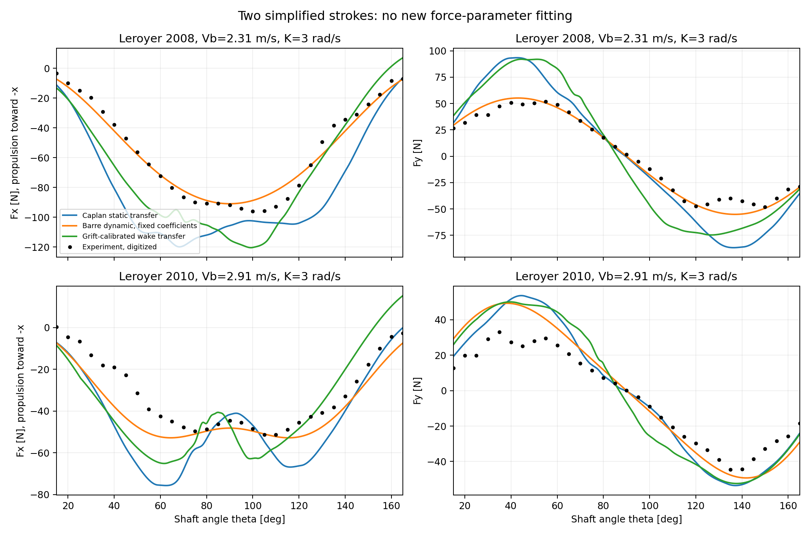
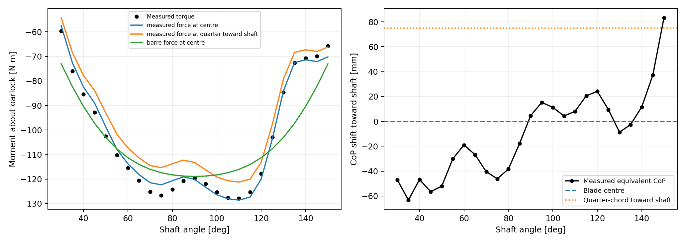

# 桨叶自由液面与运动历史耦合：Leroyer 全文补充及整划程验证

日期：2026-10-24。所有新增实现及结果位于本独立研究目录，未修改原始机器人、船体 XML 或网格。

## 1. 本轮得到什么结论

已分析用户提供的 Leroyer 2010 全文，并从 HAL 取得其 2008 年前序论文。新增两个推进参数下的整划程力曲线对比、一个划程的力矩与压力中心检查，以及带适用范围限制的 Barré 动态力模型。没有用这些新增力曲线重新拟合参数。

结果支持三项实质修订：

1. **自由液面与非定常作用必须联合描述。** 同一篇论文中，自由液面对静态和动态阻力系数的影响方向相反，因此不能把深水非定常增量直接加到近水面静态极线上。
2. **不能把固定压力中心当作通用改进。** 新工况下，固定四分之一弦长的力矩误差比桨面中心更大。合力预测准确也不等于桨轴力矩准确。
3. **动态经验模型有明确适用条件。** 新的整划程实现优于直接迁移静态极线，但 2010 工况的推进冲量仍偏高约 20.6%；现有模型仍不能称为对任意人形机器人划桨已验证的高精度模型。

## 2. 原文与数据来源

| 文献 | 本轮获取与使用 | 独立性说明 |
|---|---|---|
| Leroyer, Barré, Kobus & Visonneau (2010), *Influence of free surface, unsteadiness and viscous effects on oar blade hydrodynamic loads*, J. Sports Sciences 28(12), 1287-1298, [DOI](https://doi.org/10.1080/02640414.2010.485646) | 用户提供 13 页 PDF，包含 HAL 封面；全文已读。Fig.7-11 用于物理因素分析；Fig.9-10 实验曲线用于定量比较。 | 实验来自 Barré 1998 Nantes 拖曳水池数据库；与 Barré & Kobus 2010 有来源关联。 |
| Leroyer, Barré, Kobus & Visonneau (2008), *Experimental and numerical investigations of the flow around an oar blade*, J. Marine Science and Technology 13, 1-15, [DOI](https://doi.org/10.1007/s00773-007-0256-7), [HAL 全文](https://hal.science/hal-00699499/document) | 新取得 16 页 PDF，包含封面。Fig.2 给出桨尺寸和外力臂；Fig.19、20b、21 提取实验力、力矩和压力中心。Fig.18 和 Fig.20a 是同组数据的时间轴重绘，不重复计数。 | 增加另一推进参数的工况，不是独立实验机构或独立实验数据库。 |
| Morgan et al. (2026), *Optimisation of performance rowing blades*, [DOI](https://doi.org/10.1177/17543371261450294) | 用户也无法获取全文；继续标记为未读全文。 | 未使用其未核实的数据或结论标定模型。 |

两篇 Leroyer 文献中，桨始终留在水中，采用预先规定的简化转动律。它们检验的是具有划桨主要运动特征的拖曳水池实验，**不等于实测运动员轨迹、入水/出水过程或整艇自由航行验证**。已有 Grift 2021 真实轨迹缩比复现实验及船体变速实验仍见主报告。

2010 的 Fig.9-10 是较低分辨率位图。本轮读取 15° 至 165°、每 5° 一组的 31 对力值，共 62 个纵坐标；保留原图坐标、人工选点种子和 ±3 原生像素的读图误差界，并检查选点覆盖图。2008 的三个物理量和一个派生量来自 PDF 矢量曲线，共 6647 个绘图顶点；这些顶点不是独立传感器样本，更不能算成 6647 次实验。

## 3. 自由液面效应不能单独相加或相乘

Leroyer 2010 在伪攻角约 90° 处给出以下近似阻力系数，见原文 Fig.8 及其讨论：

| 条件 | $C_D$ 约值 | 证据类型 |
|---|---:|---|
| 静态、深水，无自由液面 | 1.15 | CFD 对照 |
| 静态、近自由液面 | 1.55 | CFD 对照 |
| 动态、深水，无自由液面 | 2.70 | CFD 对照 |
| 动态、近自由液面 | 2.20 | CFD 对照 |
| 动态、近自由液面实验 | 2.05 | 拖曳水池测量 |

这里四条 CFD 对照不是四组新的实验。

静态时，自由液面使 $C_D$ 增加约 $1.55/1.15-1=34.8\%$；动态时，自由液面使其减少约 $2.20/2.70-1=-18.5\%$。若把深水动态增量直接加到近水面静态结果：

$$
C_D^{\mathrm{add}}=1.55+(2.70-1.15)=3.10,
$$

比动态近水面 CFD 的 2.20 高约 40.9%，比实验约 2.05 高约 51.2%。交互项为

$$
\Delta C_D^{\mathrm{interaction}}
=2.20-2.70-1.55+1.15=-0.90.
$$

这些数字只描述该工况及所选划程位置，不是通用经验常数。其物理原因包括迎水侧液面抬升、背水侧通气空腔、液面变形输运，以及桨后半程再次进入先前扰动的水域。仅使用静水面裁切后的湿面积，不能表示这些过程。

**实现上的结论：** 现有 `BladePolar`、动态 Barré 系数、起动附加质量/历史模型应作为有条件的替代闭合，不能无条件累加。若采用分解式模型，必须用同一组运动与浸深数据联合识别剩余项，明确各项已包含的物理贡献。

原文中黏性计算与无黏计算较接近，说明在该平板、浸深及运动条件下，划程主要工作区的压力作用占主导。但两组计算还使用了不同网格，论文也没有完成严格网格收敛。因此不能把这一发现推广为“所有桨叶与船体均可忽略黏性”；原文也指出运动初末桨面近乎顺流时黏性阻力重要。船体摩擦阻力尤其不能据此删除。

## 4. 新实现：有条件的整划程动态力模型

实现：`hydrodynamics/prescribed_stroke.py`。它将已有 Barré 系数模型扩展为可计算桨面中心位置、速度、加速度、二维合力与桨轴力矩的完整实验运动基准。

参考桨为 $c=0.300$ m、竖直高度 $b=0.140$ m、面积 $S=0.042$ m² 的平面矩形桨，$L_e=1.308$ m，桨上缘位于静水面。$L_e$ 由 Leroyer 2008 Fig.2 明确给出，消除了前一轮无法确定外力臂的限制。

运动定义为

$$
\dot\theta=K\sin\theta,\qquad
\eta_0=\frac{V_b}{L_eK},\qquad
t(\theta)=\frac{1}{K}\ln\tan\frac\theta2,
$$

其中 $t=0$ 对应 $\theta=90^\circ$，船沿 $-x$ 方向运动。于是

$$
\boldsymbol r_I=
\begin{bmatrix}-V_bt-L_e\cos\theta\\-L_e\sin\theta\end{bmatrix},\qquad
\boldsymbol v_I=
\begin{bmatrix}-V_b+L_e\dot\theta\sin\theta\\-L_e\dot\theta\cos\theta\end{bmatrix}.
$$

加速度由同一运动解析求导，包含切向角加速度与向心项。伪攻角、约化频率与法向 Froude 数为

$$
i=\operatorname{atan2}\big((1-\eta_0)L_eK\sin\theta,V_b\cos\theta\big),
\quad f_r=\frac{c}{L_e(1-\eta_0)},
\quad Fr_n=\frac{(1-\eta_0)L_eK\sin\theta}{\sqrt{gc}}.
$$

这里 $f_r$ 采用 Barré 原文定义，不能与使用 $\omega c/(2U)$ 的其他约化频率不加转换地混用。两组条件如下：

| 条件 | $K$ (rad/s) | $V_b$ (m/s) | $\eta_0$ | $f_r$ | 最大 $Fr_n$ |
|---|---:|---:|---:|---:|---:|
| Leroyer 2008 | 3 | 2.31 | 0.588685 | 0.557621 | 0.940824 |
| Leroyer 2010 | 3 | 2.91 | 0.741590 | 0.887574 | 0.591075 |

2010 正文写 $\eta_0\approx0.742$，本轮使用明确的 $V_b,K,L_e$ 计算未舍入值。由此得到中划程中心法向速度 1.014 m/s，与 Table I 一致。表中的速度分量标签/个别符号不完全一致，因此以原文几何定义及运动解析式作为坐标依据，没有直接把 Table I 列当成世界坐标速度。

对于 $K=3$ rad/s，已有 Barré 回归式为

$$
C_{D,\max}=1.7224 f_r+0.7014,\qquad
C_{L,\max}=0.6359 f_r+0.3982,
$$

$$
C_D=C_{D,\max}\sin^2 i,\qquad
C_L=C_{L,\max}\sin(2i),\qquad
\boldsymbol F=\frac12\rho S|\boldsymbol v_I|^2
(-C_D\boldsymbol e_v+C_L\boldsymbol e_L).
$$

$\boldsymbol e_L$ 按原文伪攻角和实际法向来流方向确定。取水密度 1000 kg/m³。程序沿用既有回归支持范围，超出对应 $K,f_r$ 区域会报错；没有默默外推。允许几何相似、Froude 相似的尺度转换：长度放大 $s$ 倍时，参考转速为 $K\sqrt{s}$，速度按 $\sqrt{s}$、力按 $s^3$、力矩按 $s^4$ 缩放。这是相似假设，不代表不同桨型、不同展弦比或当前 CAD 桨已经通过验证。

**此闭合已经包含该运动族下的非定常与近水面效应，不再叠加独立附加质量或尾流力。** 它也不能把任意机器人轨迹的瞬时角速度代入 $K$ 后直接使用，因为 $K$ 是整段运动律的参数。

## 5. 新实验对比：保持已有参数，不重新拟合

比较三条路径：

- Caplan 静态平板极线直接迁移，保留原始系数。
- Barré 动态经验模型，使用已经存在的文献回归式。
- 前一轮在 Grift 2021 的单一校准划程上拟合的尾流动量模型，参数不变，仅更换当前几何及输入运动。

前两篇的几何、实验条件不同，所以 Caplan/Grift 的迁移误差同时包含桨型与协议差异；不能把全部差异归因于“是否非定常”。Barré 与 Leroyer 又共享实验数据库，所以其结果也不能包装为严格独立外部验证。本轮的贡献是把峰值系数比较扩大到整划程合力、冲量和力矩审查。

主比较区间为 $30^\circ\le\theta\le150^\circ$，每 5° 一对力值。力分量 RMSE 定义为

$$
E_F=\sqrt{\frac1{2N}\sum_j[(F_{x,j}-\hat F_{x,j})^2+(F_{y,j}-\hat F_{y,j})^2]}.
$$

冲量按实际非均匀时间积分 $J=\int -F_x\,dt$，不把等角度采样误作等时间采样。完整 CSV 另提供时间加权 RMSE、15°-165° 和 70°-110° 的分段指标。

| 工况 | 模型 | 力分量 RMSE (N) | 相对 RMS 误差 | 推进冲量偏差 |
|---|---|---:|---:|---:|
| 2008 | Caplan 静态迁移 | 29.35 | 51.51% | +48.04% |
| 2008 | Barré 动态模型 | **5.94** | **10.42%** | **+0.50%** |
| 2008 | Grift 尾流模型迁移 | 24.83 | 43.58% | +25.91% |
| 2010 | Caplan 静态迁移 | 16.25 | 47.69% | +41.71% |
| 2010 | Barré 动态模型 | **9.70** | **28.48%** | **+20.56%** |
| 2010 | Grift 尾流模型迁移 | 15.00 | 44.01% | +20.48% |



图中橙线较好描述 2008 工况，2010 工况早期侧向力及推进力仍明显偏大。2010 中间 70°-110° 区间的动态模型 RMSE 为 3.36 N、冲量偏差为 +3.85%，但不能只选这一段宣布整体高精度；扩展到 15°-165°，其冲量偏差达到 +30.17%。

2010 读图误差界对应 $F_x$ 约 ±0.73 N、$F_y$ 约 ±0.97 N，纵坐标读图对合并 RMSE 的最坏扰动界约 0.86 N。它不包括横坐标标定及实验本身误差，也不是统计置信区间。当前模型失配明显大于读图误差尺度。

尾流模型的迁移结果说明：先前 Grift 工况得到改善，并不代表其参数可以用于另一桨型和另一运动族；通气与自由液面状态尚未被这个单一尾流速度状态表达。没有为了改善此表而重新拟合每条实验曲线。

## 6. 力矩与压力中心验证

Leroyer 2008 给出桨轴处的力矩 $M_z$，以及沿桨轴方向、相对于桨面中心的等效作用点偏移 $d_{IP}$。正方向朝桨轴，原文关系为

$$
M_z=(L_e-d_{IP})(F_x\sin\theta-F_y\cos\theta).
$$

这也是新模块 `moment_from_force` 的定义。此处采用等效合力作用点表示二维载荷；并未据此获得完整三维压力分布或所有独立力偶。

数据审查发现：Fig.19 的侧向力轴标作 $-F_y$，而 Fig.3-4 坐标定义、Eq.(3)、Fig.20 力矩及 Fig.21 作用点共同要求将图中正值解释为物理 $+F_y$。按后一解释重建力矩，在 30°-150° 的 RMSE 为 0.027 N·m；按轴标签直接取反则为 66.41 N·m。这强烈支持该图存在符号标注不一致。Fig.20 的力矩轴单位印为 N，按其物理定义应为 N·m。本轮保留原始变量 `fy_plot` 并显式记录解释，没有悄悄改动原始图值。

注意：Fig.21 的作用点本来就是由实测力与力矩计算的，因此 **0.027 N·m 是符号、单位及数字化自洽检查，不是模型预测精度**。

为分离作用点误差，先把实测合力视为已知，仅改变它的施加位置：

| 力矩构造方式 | RMSE (N·m) | 最大绝对误差 (N·m) |
|---|---:|---:|
| 实测合力作用于桨面中心 | **2.50** | 4.48 |
| 实测合力作用于中心向桨轴偏移 $c/4=75$ mm 处 | 7.24 | 11.34 |
| 实测合力作用于中心远离桨轴偏移 75 mm 处 | 5.75 | 9.31 |
| Barré 预测合力作用于桨面中心 | 10.13 | 24.63 |



该比较区间内，实测等效作用点约从中心外侧 63 mm 变化到内侧 83 mm。前一轮另一数据集上四分之一弦长近似改善作用点位置 RMSE，不代表它能在所有工况下降低力矩误差；数据条件和评价指标都不同。机器人动力学接口最终应输出力与力矩，而不只输出推进合力。若只有合力，中心施力可以作为明确标注的基线，但不能声称压力中心已准确预测。

## 7. 对高精度桨与船体模型的下一步约束

若目标仍是不在线求解流场，当前最有证据支持的路线是 **用离线自由液面计算与实验共同构建有历史状态的载荷模型**。不能仅继续添加互相独立的标量系数。

对桨，可采用下列联合状态结构作为研究设计，而不是已识别完毕的公式：

$$
\dot{\boldsymbol z}=f(\boldsymbol z,\boldsymbol q_b,\dot{\boldsymbol q}_b,\ddot{\boldsymbol q}_b,h,\mathcal G),
\qquad
\boldsymbol\tau_b=g(\boldsymbol z,\boldsymbol q_b,\dot{\boldsymbol q}_b,\ddot{\boldsymbol q}_b,h,\mathcal G),
$$

其中 $\boldsymbol\tau_b$ 包含力和力矩；$\mathcal G$ 表示真实桨几何；$\boldsymbol z$ 至少要能区分尾流记忆与近水面通气状态。它可由局部诱导速度、环量/涡位置、空腔或有效受水面积等低阶变量构成，也可用带物理约束的递归代理模型实现。具体状态维度、演化方程和系数尚不能从本轮两条曲线唯一确定，不能预设它们已被实验验证。

离线数据应交叉改变浸深、划频/加速度、前进速度、安装角与入出水过程，保留至少一整组轨迹和浸深组合不参与拟合。输出至少包含 $F_x,F_y,F_z$ 与桨轴力矩，并报告冲量、功、峰值和相位误差。对 CFD 必须检查自由液面附近以及桨二次进入尾流区域的网格与时间步；原文明确说明粗网格引起的通气界面数值扩散会污染后半程力，不能把未经收敛检查的 CFD 直接当作精确真值。

对船体，Leroyer 的新证据仅涉及桨，**本轮没有新增船体实验精度结论，也没有据桨叶结论删掉船体黏性项**。船体继续采用：

$$
\boldsymbol\tau_h=
\boldsymbol\tau_{\mathrm{hydrostatic}}
+\boldsymbol\tau_{\mathrm{steady}}(U,\mathrm{trim},\mathrm{draft})
+\boldsymbol\tau_{\mathrm{radiation/history}}
+\boldsymbol\tau_{\mathrm{crossflow/fin}},
$$

并保证稳态兴波阻力不与记忆核的零频贡献重复计入。主报告的 Day 船速波动与四个平均阻力结果、Dode 的 98 个可见实验点继续有效，但平均阻力无法唯一识别瞬时附加质量和记忆核。Dode 附录理论曲线的复现差异也尚未解决。当前 CAD 船体的瞬态六分量载荷仍缺直接验证，原文小船模型的拟合精度不能自动转移给它。

## 8. 文件、复现与核验

- `hydrodynamics/prescribed_stroke.py`：受适用域限制的运动与动态载荷闭合、相似缩放、力矩计算。
- `tools/extract_leroyer_experiment.py`：2010 原始像素读数和 2008 矢量路径提取。
- `tools/compare_leroyer_experiments.py`：参数固定的整划程迁移比较与力矩检查。
- `data/leroyer2010_force_trajectory.csv`、`data/leroyer2008_force_moment.csv`：图表数字化数据。
- `data/provenance_leroyer2010.json`、`data/provenance_leroyer2008.json`：原文哈希、坐标标定、来源关联和符号说明。
- `results/leroyer/metrics.csv`、`verification.json`、`force_comparison_*.csv`、`moment_comparison_2008.csv`：可复查结果。

提取命令使用有 `pdfplumber` 的 Python 环境，将两篇原始 PDF 路径传入：

```powershell
python tools/extract_leroyer_experiment.py <Leroyer2010.pdf> --earlier-pdf <leroyer2008.pdf> --inspection-dir <scratch-directory>
python tools/compare_leroyer_experiments.py
python -m pytest tests -q
```

本轮完整检查为 **20 项测试通过**，新增检查覆盖位置/速度/加速度一致性、Froude 相似的力与力矩缩放、经验支持域拒绝及耗散符号。原图选点覆盖图和最终两张比较图已经视觉核查。数值和几何一致性测试通过，只能证明相应实现满足这些检查，不能替代上述仍有明显残差的物理验证。

额外将尾流积分的每步 RK4 子步数从 4 加倍到 8，两个工况在 30°-150° 区间的力分量差异 RMSE 均低于 $3\times10^{-9}$ N。因此本次尾流模型迁移误差并非该子步积分精度造成；输入、模型结构和参数适用性问题仍需独立处理。
