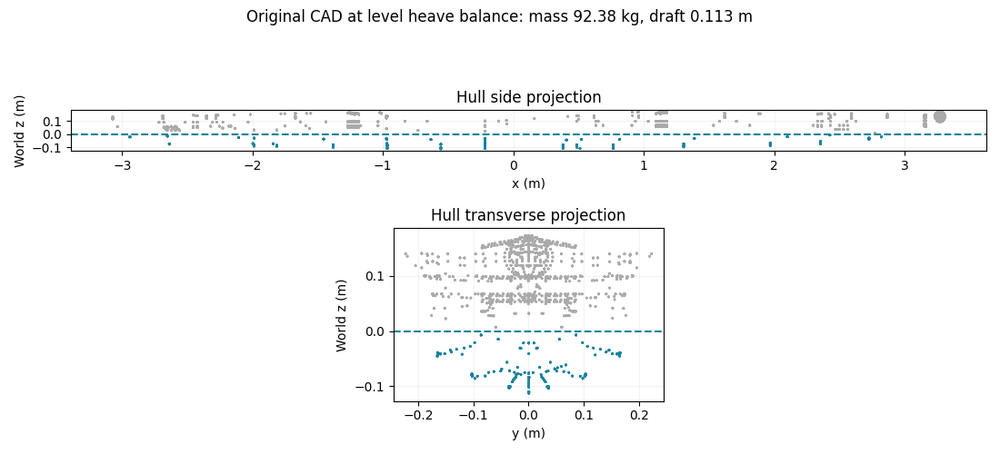
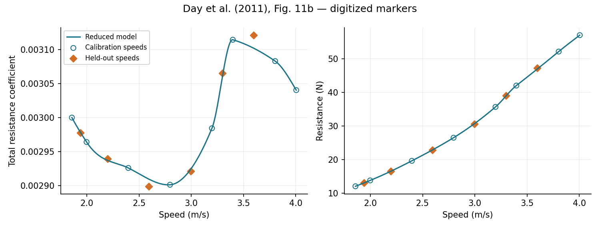
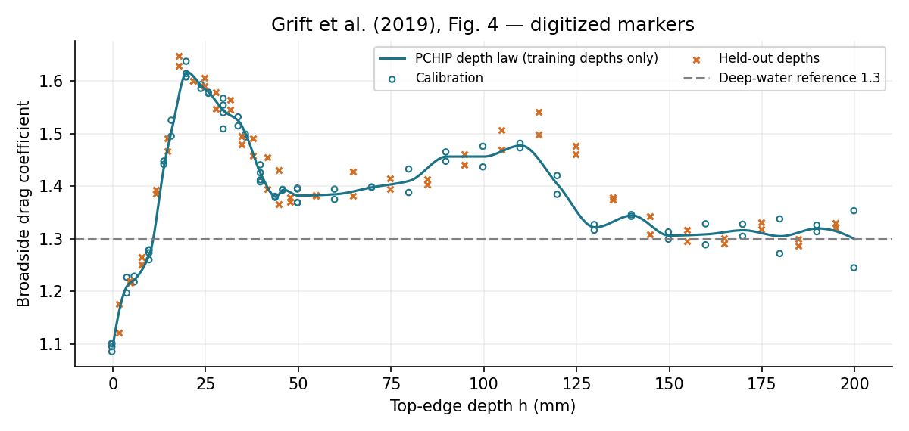
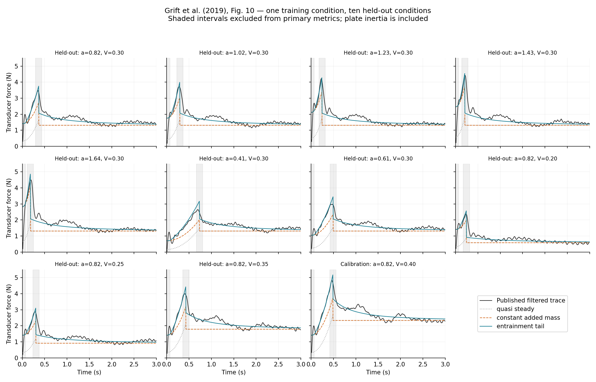

# 划桨推进系统：低阶水动力模型与文献实验对比

后续扩展见 [新增文献、改进模型与跨工况验证](HYDRODYNAMICS_EXTENDED_REPORT.md)：新增 Caplan 2007、Barré 2010、Reijtenbagh 2026 的数字化实验数据，静态升阻力曲线、转动工况响应面和历史力模型。本文件保留为初版基线；新模型的适用边界和未改善的结果在扩展报告中说明。

日期：2026-10-24。基于 [kingfloydz/rowing](https://github.com/kingfloydz/rowing) 的提交 `aaa31478ccb7eac62993865e3c4aac64313eeccf`。

**已建立可执行的低阶水动力模型，并完成船体阻力、桨板浸深效应和非定常受力的文献图表数据对比。当前结果属于部件模型的留出工况检验，不能表述为“仓库机器人整艇已通过实验验证”。** 原仓库使用 H2 + Dex1，并非 G1；本次按实际场景建模。原始 XML、机器人、船和桨资产均未改动。

## 1. 采用哪些实验，以及它们能够证明什么

| 来源 | 采用的数据 | 本次用途 | 证据边界 |
|---|---|---|---|
| Day 等，2011，*An experimental study of unsteady hydrodynamics of a single scull* | Fig. 11(b) 单人双桨艇、自然转捩拖曳阻力系数；14 个橙色菱形点 | 分解摩擦阻力与剩余阻力，检验留出速度点的插值 | 实验艇与仓库 CAD 不同；水槽深度约 2.15 m，剩余阻力也包含该试验环境的影响 |
| Grift 等，2019，*Drag force on an accelerating submerged plate* | Fig. 4 桨板稳态阻力系数—浸深关系 | 标定近自由表面效应，留出整个浸深组检验 | 0.20 × 0.10 m 平板正向平移；不能验证实际桨的全攻角升阻力 |
| 同上 | Fig. 10 加速度、终速变化下的测力时程 | 比较准稳态、固定附加质量、非定常修正模型 | 一次直线起动过程，不是周期往复划桨实验 |

文献原文：[Day 论文 PDF](https://strathprints.strath.ac.uk/35941/1/IMechE_An_experimental_study_of_unsteady_hydro.pdf)，[Grift 论文及 DOI](https://doi.org/10.1017/jfm.2019.102)。摩擦阻力采用 [ITTC 阻力试验规程](https://ittc.info/media/9595/75-02-02-01.pdf) 中的 ITTC-1957 关联线。

**数据不是作者提供的原始测量记录。** Grift 的曲线和散点由出版 PDF 的矢量坐标提取；Day 的点由 PDF 第 12 页、150 dpi 渲染图的橙色标记提取。数据、坐标、页码、来源和 PDF SHA-256 均有记录，见 [数据来源清单](data/provenance.json) 和 [提取脚本](tools/extract_experiments.py)。Grift 时程本身已经过论文中的滤波处理，无法恢复原始采样与测量误差。

Day 图像读数误差按约 ±2 像素记录，对应阻力系数约 ±8.97×10⁻⁶、速度约 ±0.0084 m/s；它只是读图精度，不是实验置信区间。Grift Fig. 4 标记与网格有约 0.24 mm 的系统偏移，按最近整数毫米分组，原始坐标仍保留。提取的 144 个可辨标记中，134 个归入 h≥0，10 个部分浸没点仅保留存档。不能从这些标记恢复作者逐次试验编号或把它们当作新增独立实验。

## 2. 仓库几何与坐标约定

世界系 Z 向上，静水面 z=0；船局部 X 沿船长，Y 横向。桨局部 Y 沿桨杆，桨叶薄厚方向近似局部 X。所有速度均使用相对水的速度，所有单位为 SI。

| 项目 | 从当前模型得到的值 |
|---|---:|
| 整套船—机器人—桨质量 | 92.3764 kg |
| 船体外形总长 | 6.3791 m |
| 每片桨叶投影面积 | 0.0755813 m² |
| 桨叶展长 | 0.481074 m |
| 桨叶最大垂向弦长 | 0.200603 m |
| 面积等效弦长 A/b | 0.157110 m |
| 桨叶 X 向最大包围厚度 | 0.003 m，**不是恒定壁厚** |
| MuJoCo 状态与驱动 | nq=46、nv=45、nu=0，无现成执行器或划桨控制器 |

桨叶面积由 STL 三角面向 YZ 平面投影后求并集得到，保留凹边界；不是用外接矩形或凸包代替面积。再把该投影划分为三角片，计算局部湿润面积与速度。

`shell_white.stl` 含两个封闭部分和一个孤立三角面。浮力采用两个封闭部分组成的排水包络，省略孤立面；不再叠加 `deck_blue`，避免大范围重复计算排水体积。两段连接处有毫米级重叠、闭合端面，目前未作严格布尔并集；湿表面积仍按两段闭合表面求和，连接处人工端面可能造成偏差。这是当前 CAD 转水动力几何的明确近似。未建模进水，不能用于大倾角翻覆后的浮力预测。

在原装配姿态、水平船身下，仅调整升沉得到：船体原点 z≈0.119394 m，吃水≈0.112767 m，湿润长度≈5.877657 m，船体湿表面积≈2.367060 m²；船体与桨叶总浮力≈906.2125 N，与整套重量相平衡。

**这只是升沉平衡，不是完整静力平衡。** 关于系统质心仍有约 −5.25 N·m 横摇力矩和 +1.33 N·m 纵摇力矩；不能据此认为机器人能够自行保持姿态。细节见 [场景检查记录](results/scene_audit.json)。



## 3. 在线受力模型

模型核心见 [models.py](hydrodynamics/models.py)，MuJoCo 耦合见 [mujoco_adapter.py](hydrodynamics/mujoco_adapter.py)。静水、刚性艇体与桨叶、不可压缩水作为基本假设，取 ρ=1000 kg/m³、g=9.81 m/s²、ν=10⁻⁶ m²/s；ν 为名义淡水值，并非从原文水温反演。

### 3.1 几何浮力及恢复力矩

把封闭几何表面三角片裁剪到水面以下，按静水压力积分：

\[
\mathbf F_B=-\int_{S_w}\rho g(\eta-z)\mathbf n\,dS,\qquad
\mathbf M_B=-\int_{S_w}(\mathbf r-\mathbf r_O)\times\rho g(\eta-z)\mathbf n\,dS.
\]

三角片上压力线性变化，力与力矩分别作精确的一阶、二阶多项式积分。裁剪平面的表压为零，无需另加水面封口压力。此方法自然产生升沉、纵摇、横摇恢复项，无需另叠加人为浮力弹簧。在线计算船体和桨叶浮力，未单独加入尾鳍、桨杆排水量。

### 3.2 船体纵向阻力

\[
R_x=\tfrac12\rho S_w U^2\big[(1+k)C_F(Re)+C_R(Fn)\big],\quad
C_F=\frac{0.075}{(\log_{10}Re-2)^2},
\]
\[
Re=|U|L_w/\nu,\qquad Fn=|U|/\sqrt{gL_w},\qquad k=0.012.
\]

作用方向与船体纵向相对速度相反。`k=0.012` 来自 Day 的自然转捩 Prohaska 拟合；`C_R` 由**标定点**的总阻力系数扣除摩擦项后作 PCHIP 插值。把同一 `C_R(Fn)` 迁移到仓库几何，只是一种相似性假设，剩余阻力不能被解释为已单独辨识的纯兴波阻力。

载荷作用点取湿表面的面积加权中心，是阻力作用线近似，并非实验辨识的阻力中心。低于最小试验 Fn 时令 `C_R∝Fn⁴`，超过最大 Fn 时固定剩余系数；低 Re 对关联线作下限正则化。这些范围外处理仅保证计算可用，不构成实验证实。

Day 原艇 Lw=7.937 m、Sw=2.340 m²、排水量118.4 kg；本次提取速度约1.857–4.004 m/s。对应当前静态 CAD 湿润长度的相同 Fn 区间约为 **1.60–3.45 m/s**。当前几何在1、2、3、4 m/s的模型阻力约为3.98、14.89、35.20、59.92 N，其中1、4 m/s属于范围外处理结果，全部数值均不是当前船型的实测阻力。

### 3.3 横向与垂向阻尼、尾鳍

船体湿面采用横向/垂向局部压力阻尼：

\[
d\mathbf F_\perp=-\tfrac14\rho C_\perp
|\mathbf v_\perp\cdot\mathbf n_\perp|
(\mathbf v_\perp\cdot\mathbf n_\perp)\mathbf n_\perp dS.
\]

在船体系去除纵向分量，避免与纵向标定阻力重复；系数1/4把闭合表面的双侧压力阻尼作对称分配。尾鳍同样只计算非纵向阻尼，纵向效应已包含在迁移的总阻力近似中。默认 `C_perp=1`、尾鳍系数1均为**待标定假设**。该闭合关系耗散能量，但未由横荡、升沉、偏航实验验证，也不能代替尾鳍升力曲线。

### 3.4 桨叶准稳态载荷

第 i 个湿润片的相对水速为：

\[
\mathbf v_i=\mathbf v_O+\boldsymbol\omega\times(\mathbf r_i-\mathbf r_O)-\mathbf u_w.
\]

采用薄平板法向力近似：

\[
\mathbf F_{N,i}=-\tfrac12\rho A_{w,i}C_{D,90}(h/c)
|\mathbf v_i|(\mathbf v_i\cdot\mathbf n)\mathbf n,
\quad
\mathbf M_N=\sum_i(\mathbf r_i-\mathbf r_O)\times\mathbf F_{N,i}.
\]

`C_D,90(h/c)` 用 Grift Fig.4 的标定浸深组建立；h 是**桨板上缘到静水面的深度**，不是质心深度。h=0 表示上缘恰好在水面，而非湿润面积为零。部分入水时按实际湿润面积裁剪，并暂用h=0的系数，未声称标定了入水冲击或通气。

对于流向与板面夹角 α，这一闭合等价于 `C_D=C_D,90 sin²α`，升力分量由同一法向力投影得到，幅值系数为 `C_D,90|sinα cosα|`。因此不能再叠加一套同源升力而重复计力。该全攻角推广、实际曲面桨形影响、转动过程和切向摩擦尚未通过本次实验检验。

### 3.5 桨叶附加质量及隐式耦合

采用 Grift Eq.(3.3) 转述的 Patton 平板表达式：

\[
m_A=0.84\frac{\pi}{4}\rho b c_e^2,\qquad c_e=A/b.
\]

对于文献0.20×0.10 m平板，mA≈1.31947 kg。实际桨按等效矩形估计，全湿mA≈7.834 kg；0.84原本对应展弦比2，迁移到当前非矩形桨是一项未验证的几何外推。部分浸没时再按湿面积比例缩放，此项亦属近似。

在线采用每片桨一个湿面积中心的法向平动附加质量：

\[
\mathbf F_A=-m_A\mathbf n(\mathbf n\cdot\mathbf a_P),\quad
\mathbf a_P=J_P\ddot q+\dot J_P\dot q.
\]

每一步冻结法向与湿润比例，把 `B=nᵀJ_P` 对应的反力与 MuJoCo 加速度同时求解，使 `f_A+m_A(B qddot+b)=0`；保留原有抓握/脚部约束，并检查方程残差。避免直接使用上一时刻加速度造成附加质量反馈不稳定，也避免把流体质量加入 XML 干质量后重复计入。

**该在线项是有限范围的平动近似。** 未包含完整六自由度附加质量矩阵、转动附加惯量、旋转坐标相关项、湿润质量变化率和入水冲击；有转动或反复入出水时不能声称严格满足完整流体动能守恒。船体附加质量及辐射记忆也尚未辨识。

## 4. 起动实验中的非定常修正

这部分在独立的规定运动实验脚本中比较，**没有未经验证地直接移植为周期划桨在线模型**。船体和机器人已有干质量；只有在复现实验测力装置时，才把平板自身惯性 `mp*a` 加到传感器预测值中。

试验设定：b=0.20 m、c=0.10 m、mp=0.40 kg、h=0.10 m；给定加速度a，达到终速V后匀速，`tc=V/a`。

三个模型分别为：

\[
M_0:\quad F= m_p a(t)+\tfrac12\rho A C_D v(t)^2,
\]
\[
M_1:\quad F=M_0+m_Aa(t),
\]
\[
M_2:\quad F=M_1+\mu a\max(t-t_{sr},0),\qquad 0\le t<t_c.
\]

`tsr=0.07 s` 是论文给出的装置起动响应时间；加速时随时间增长的附加载荷借鉴 Grift Eq.(4.1)。本文保留 Patton mA，没有混用另一表达式。加速停止后的均值包络采用显式说明的经验延拓：

\[
F=M_0+\frac{\beta(\tfrac12\rho A V^2)}{[1+\theta/\lambda]^2},
\qquad \theta=(t-t_c)V/c,\quad t\ge t_c.
\]

该衰减包络受论文对形成时间和尾流衰减讨论启发，**不是论文给出的 h=0.10 m 全时程精确模型**；它不会恢复两次涡脱落峰值。固定附加质量在停止加速时的跳变和装置振动也未建模。

仅用 Fig.10(b) 的 **a=0.82 m/s²、V=0.40 m/s** 标定动态参数：加速段0.09 s至tc−0.04 s拟合μ；tc+0.07 s以后拟合β、λ。得到：

| 参数 | 数值 | 来源 |
|---|---:|---|
| CD，h/c=1 | 1.4565635 | 独立的 Fig.4 稳态浸深标定 |
| mA | 1.319469 kg | 文献平板公式 |
| μ | 4.287100 kg/s | 唯一动态标定工况 |
| β | 0.845085 | 同一工况的衰减包络 |
| λ | 3.587779 | 同上 |

其余10个工况不再逐条拟合。Fig.10(a)和10(b)均含a=0.82、V=0.30，比较时保留前者，剔除后者以免同一条件重复计数。全部参数见 [parameters.json](data/parameters.json)。

## 5. 定量比较结果

**船体阻力。** 14个速度点中8个标定、6个留出。留出点的阻力系数RMSE=9.20×10⁻⁶，与读图精度为同一量级；按论文湿面积和名义水密度从Ct换算为阻力后，RMSE=0.126 N，MAPE=0.219%。它说明同一实验艇的阻力曲线可被较好插值，不能用于宣称当前CAD误差小于1%。



**桨板稳态浸深。** 31个浸深组用于标定，30组、60个标记用于留出检验；不把同一深度的重复点分到两侧。留出点CD的RMSE=0.03534，MAPE=1.726%。这也说明把整个浅浸区统一设为CD=1.3会忽略明显的自由表面效应。



**非定常桨板载荷。** 比较的是传感器总力，包含平板干质量的惯性项。曲线统一在0.005 s间隔、约0–3 s区间插值计算，避免PDF曲线顶点密度左右统计权重；此举不增加独立实验样本量。

| 模型 | 10个留出工况：完整窗口RMSE | 完整窗口NRMSE/平均力 | 去除装置过渡窗口后RMSE |
|---|---:|---:|---:|
| M0 准稳态 | 0.665 N | 41.30% | 0.513 N |
| M1 固定附加质量 | 0.473 N | 29.35% | 0.361 N |
| M2 增长附加载荷＋衰减包络 | **0.259 N** | **16.08%** | **0.148 N** |

最后一列剔除t<0.07 s和停止加速前后各0.07 s。为避免通过排除难预测时段夸大精度，完整窗口误差一并作为主要结论报告。M2完整窗口RMSE较M0降低约61.1%，较M1降低约45.2%；但仍无法复现初始装置振动和后续局部涡峰。

NRMSE定义为 `RMSE / mean(abs(F_exp))`，不是除以峰值或力幅。未进行误差条或置信区间推断，因为缺少原始重复试验与传感器不确定度。逐工况、峰值和全时程数据见 [误差明细](results/unsteady_metrics.csv)、[预测数据](results/unsteady_predictions.csv)、[汇总指标](results/metrics.json)。



## 6. 耦合检查与当前使用方式

已通过7项针对性检查：解析长方体浮力与力矩、旋转全浸物体浮力、阻力耗散与反向对称性、左右桨面积及离水截止、附加质量与解析质量和解一致、系数数量级，以及实际场景的外加载荷保留与短时积分。

实际H2场景保留原有约束，从升沉平衡状态给定1 m/s初始前进速度，完成50步、0.1 s有限状态检查，附加质量方程残差小于10⁻⁴ N。**这不是划桨控制演示，也不是长时间稳定性证明。** 无执行器/控制时，机器人姿态和船体姿态自然会改变。

安装依赖后，在当前仓库副本运行：

```bash
python -m pip install -r requirements-hydrodynamics.txt
python tools/compare_experiments.py
python tools/check_scene_hydrodynamics.py
python -m pytest tests/test_hydrodynamics.py -q
python tools/summarize_results.py
```

最小接入接口：

```python
import mujoco
import numpy as np
from hydrodynamics.mujoco_adapter import RowingHydrodynamics, Water

m = mujoco.MjModel.from_xml_path("scene.xml")
d = mujoco.MjData(m)
hydro = RowingHydrodynamics(m, water=Water(level=0.0))
j = m.joint("boat_free").id
d.qpos[m.jnt_qposadr[j] + 2] = 0.11939430382  # 仅本场景原姿态升沉参考
mujoco.mj_forward(m, d)
external = np.zeros(m.nv)   # 接入自己的关节控制/外载荷
diagnostics = hydro.step(d, external_qforce=external, added_mass=True)
```

`step` 自行推进一次仿真，调用后不要再重复调用 `mj_step`。接口默认每步重新写入广义外力，已有控制器提供的 `qfrc_applied` 应通过 `external_qforce` 显式传入。原来的 `ctrl` 执行器输入由MuJoCo处理。接口支持Euler/implicitfast，不支持RK4多阶段水动力重算。它是CPU参考实现，尚未移植到GPU并行训练框架。

复现PDF提取另需Poppler的`pdftoppm`：

```bash
python tools/fetch_reference_sources.py --sources YOUR_REFERENCE_DIRECTORY
python tools/extract_experiments.py --sources YOUR_REFERENCE_DIRECTORY
python tools/compare_experiments.py
```

现有CSV足以复现本次拟合与对比，不必重新下载PDF；下载脚本会校验论文版本哈希。工作环境版本保存在 [环境记录](results/environment.json)。

## 7. 论文中应如何表述，以及下一步验证重点

可据本次结果表述：**“建立了静水浮力、船体经验阻力与桨叶非定常载荷相结合的低阶模型；利用公开文献中的拖曳与加速平板实验图表进行参数标定和留出工况检验，并完成与人形机器人—双桨艇多体动力学模型的耦合实现。”** 随后应明确区分在线近似与规定起动工况的非定常扩展。

不能表述为“已全面验证人形机器人划桨水动力”“整艇速度误差小于1%”或“已验证任意攻角和周期划桨”。当前仍缺少本艇型拖曳数据、实际桨型全攻角数据、周期划桨非定常数据；还未包含船体辐射附加质量/记忆、波浪激励、空气阻力、桨—船尾流相互作用、完整转动附加惯量和入水冲击。

对后续控制研究，优先补齐**同一CAD船体的阻力曲线**和**实际桨的周期运动受力**。可通过离线CFD或实测获取，保留独立工况验证；再把尾流修正改为有状态、可处理换向与离水重置的模型。否则策略可能利用模型在高转速、浅入水或高频换向时的缺项取得虚假收益。这是需要用后续证据解决的模型边界，不能仅靠增大训练量消除。

## 参考文献

1. Grift, E. J., Vijayaragavan, N. B., Tummers, M. J., Westerweel, J. (2019). *Drag force on an accelerating submerged plate*. Journal of Fluid Mechanics, 866, 369–398. [DOI:10.1017/jfm.2019.102](https://doi.org/10.1017/jfm.2019.102). 本次使用Fig.4、Fig.10、Eq.(3.3)、Eq.(4.1)；原文CC BY 4.0，数据经过本项目提取与处理。
2. Day, A. H., Campbell, I., Clelland, D., Cichowicz, J. (2011). *An experimental study of unsteady hydrodynamics of a single scull*. Proceedings of the Institution of Mechanical Engineers, Part M: Journal of Engineering for the Maritime Environment, 225(3). [DOI:10.1177/1475090211406775](https://doi.org/10.1177/1475090211406775). 本次使用Table 1和Fig.11。
3. ITTC. *Recommended Procedures and Guidelines: Resistance Test*, 7.5-02-02-01. [规程PDF](https://ittc.info/media/9595/75-02-02-01.pdf). 本次使用ITTC-1957摩擦关联线；不声称执行了该规程的完整实验流程。
