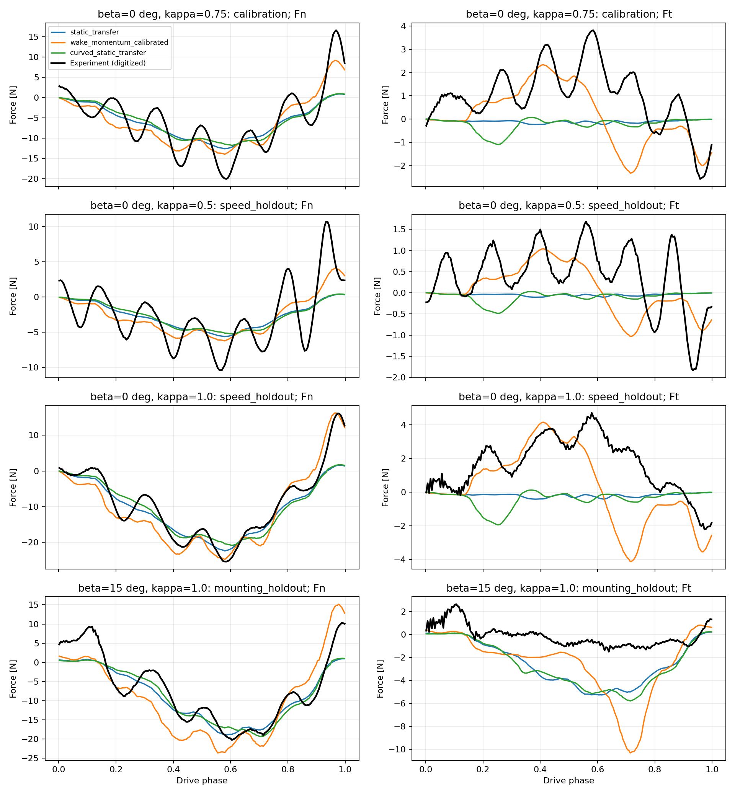
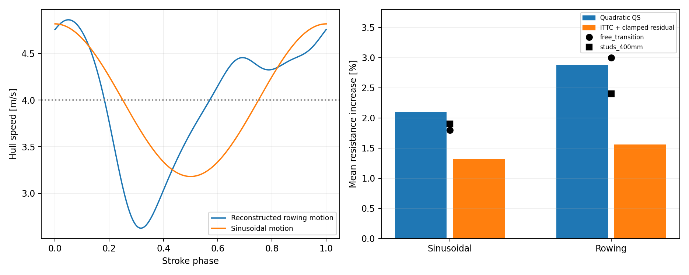
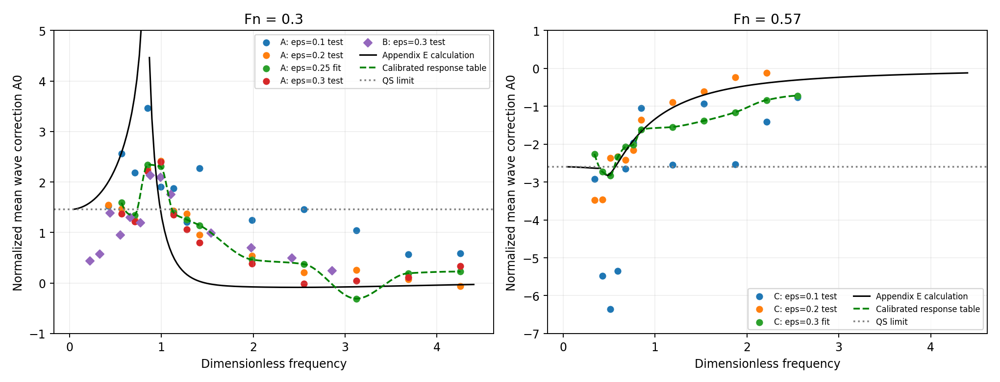

# 船体与桨叶非定常水动力：真实轨迹验证与模型修订

日期：2026-10-24。工作位于独立研究目录 `outputs/rowing_hydrodynamics`。

**后续更新：** 已读取用户补充的 Leroyer 2010 全文，并取得 Leroyer 2008 全文，新增两个简化划程的力对比及一个划程的力矩对比。自由液面与非定常效应不能独立叠加；固定四分之一弦长作用点也不是通用修正。结果、限定适用范围的动态模型及数据符号核查见 [Leroyer 补充报告](HYDRODYNAMICS_LEROYER_REPORT.md)。下文原有真实轨迹与船体验证结果继续保留。

本轮已建立真实划桨轨迹的逐时刻测力对比，增加变速船体的频率、幅值和尺寸对比，并实现尾流动量状态、旋转附加质量、兴波记忆核及有适用范围限制的实验响应表。**现有证据仍不支持把它称为适用于当前船、桨及任意控制策略的“已验证高精度模型”。** 两个划速保留工况得到改善，但改变桨叶安装角后的预测变差。这一失败结果保留在全部图表和 CSV 中。

这里的“真实轨迹”指从水上划桨记录获得、再由水槽机器人复现的缩比运动。它不同于当前人形机器人与单人双桨艇的整系统实船验证。数据来自论文图表数字化，未取得作者的原始传感器记录。

**本轮文献与可用证据**

| 文献 | 获取情况 | 对本课题的实际作用 |
|---|---|---|
| Grift, Tummers & Westerweel (2021), *Hydrodynamics of rowing propulsion*, JFM 918 A29, [DOI](https://doi.org/10.1017/jfm.2021.318) | 全文 | 水上记录、缩比机器人轨迹、法向/切向力、推进/侧向力、PIV；本轮桨叶逐时刻对比的核心依据。 |
| Dode et al. (2022), *Wave drag during an unsteady motion*, JFM 951 A15, [DOI](https://doi.org/10.1017/jfm.2022.592) | 新取得全文 | 三种相似船模、不同速度波动幅值及频率；说明平均兴波阻力修正可正可负。提取 Fig.14 的 99 个点，其中 98 个在可见坐标范围内。 |
| Day et al. (2011), *An experimental study of unsteady hydrodynamics of a single scull*, [DOI](https://doi.org/10.1177/1475090211406775) | 全文 | 重建 Fig.3 的真实划船船速波动，使用 Table 4 的四个平均阻力结果；这些不提供瞬时附加质量验证。 |
| Day et al. (2011), *Realistic evaluation of hull performance for rowing shells, canoes, and kayaks in unsteady flow*, [DOI](https://doi.org/10.1080/02640414.2011.576691) | 新取得作者稿全文 | 浅水、Wigley 船模和边界层转捩；作者稿 Fig.5 图像缺失，不能据空白页提取数据。与同团队其他文章有实验关联，不算完全独立验证。 |
| Labbé et al. (2019), *Physics of rowing oars*, New Journal of Physics 21 093050, [DOI](https://doi.org/10.1088/1367-2630/ab4226), [开放全文](https://arxiv.org/abs/1904.09338) | 新取得全文 | 有固定船体拉桨与缩比机器人船实验，适合检查桨—船耦合与力控制。其恒力近似及平板参数不能直接当作真实划桨的全角度水动力。未伪造新的定量复现结果。 |
| van Nieuwburg et al. (2023), *Improving rowing performance by adjusting oar blade size and angle*, [DOI](https://doi.org/10.3389/fspor.2023.1109494) | 全文 | 1:5 机器人船，改变桨面积与安装角，具有船速、驱动位移、力和功数据。是下一阶段整系统验证的重要来源；文中驱动端力不能直接当作桨叶水动力。 |
| Caplan & Gardner (2007), *A fluid dynamic investigation of the Big Blade and Macon oar blade designs in rowing propulsion*, [DOI](https://doi.org/10.1080/02640410600809985) | 用户提供全文 | 在已有平板极线之外，补充纵向弯曲 Big Blade 静态极线，检验更换静态形状能否消除真实轨迹误差。 |
| Barré & Kobus (2010), *Comparison between common models of forces on oar blades and forces measured by towing tank tests*, [DOI](https://doi.org/10.1243/17543371JSET43) | 用户提供全文 | 保留上轮旋转运动系数、作用点验证结果；动态系数不可与独立非定常项无条件相加。 |
| Gierczak-Galle et al. (2020), *Unsteady Wave Drag on a Disturbance Moving Along an Arbitrary Trajectory*, [作者全文](https://www.off-ladhyx.polytechnique.fr/people/benzaquen/publications/Gierczak2020.pdf) | 检索到作者公开全文，未作为本轮定量数据源 | 支持沿任意轨迹保留波场历史，而不是只查询瞬时航速阻力。 |
| Eldredge & Jones (2019), *Leading-Edge Vortices: Mechanics and Modeling*, [DOI](https://doi.org/10.1146/annurev-fluid-010518-040334) | 检索到综述及作者页面，未宣称完成全文复现 | 下一步采用有位置和环量状态的前缘/后缘涡模型的理论依据。 |
| Leroyer et al. (2010), *Influence of free surface, unsteadiness and viscous effects on oar blade hydrodynamic loads*, [DOI](https://doi.org/10.1080/02640414.2010.485646) | 用户已补充全文，完成分析 | 提取 Fig.9-10 实验曲线，增加整划程对比；自由液面与非定常交互作用见补充报告。 |
| Leroyer et al. (2008), *Experimental and numerical investigations of the flow around an oar blade*, [开放全文](https://hal.science/hal-00699499/document) | 后续取得全文并分析 | 明确 1.308 m 外力臂，提取另一推进参数下的力、力矩和压力中心。与 Barré 及 Leroyer 2010 属于同一数据库。 |
| Morgan et al. (2026), *Optimisation of performance rowing blades*, [DOI](https://doi.org/10.1177/17543371261450294) | 全文仍未获取，用户也无法获取 | 弯曲桨形与实验/计算比较。仅掌握摘要，未把其结论当作已读全文证据。 |

此前的 Grift (2019) 加速平板、Reijtenbagh 等 (2026) 非恒加速度实验及其误差结果继续见 `HYDRODYNAMICS_EXTENDED_REPORT.md`。它们检验的运动与本轮转动划桨不同，不能合并成一个笼统的“模型精度”。

**桨叶模型应保留的状态与方程**

对实际几何，仍应对湿润桨面或条带积分。条带处的相对速度为

\[
\mathbf v_r(\mathbf r)=\mathbf v_O+\boldsymbol\omega\times\mathbf r-\mathbf u_\infty-\mathbf w,
\qquad
d\mathbf F_{qs}=\tfrac12\rho |\mathbf v_r|^2
[-C_D\mathbf e_v+C_L\mathbf e_L],dA.
\]

\(\mathbf w\) 是局部尾流诱导速度，不能混入船体速度；\(C_D,C_L\) 的几何、攻角、浸深及运动适用范围必须明确。实际项目已有湿润几何、条带速度和静态极线模块；本轮实验基准只在文献提供的桨尖参考运动上使用等效集中力，尚没有该实验桨叶的完整三维表面与压力分布。

本轮增加了一个可进行能量检查的尾流动量候选模型：

\[
\mathbf F_{qs}=\mathbf F_{qs}(\mathbf v-\mathbf w),\qquad
m_w\dot{\mathbf w}=-\mathbf F_{qs}-m_w\lambda\mathbf w,
\quad m_w=C_w\rho Ac,
\quad\lambda=\frac{|\mathbf v|}{\ell_wc}.
\]

它允许减速桨叶受到先前加速的水体推动，从而产生力反向。这个低阶闭合是本研究提出的候选形式，依据是文献观察到的尾流追赶现象，**并非 Grift 原文给出的经验公式**。若静态阻力系数非负，则桨—尾流系统的功率满足

\[
\mathbf F_{qs}\cdot\mathbf v+
\frac{d}{dt}\left(\tfrac12m_w|\mathbf w|^2\right)
=\mathbf F_{qs}\cdot(\mathbf v-\mathbf w)-m_w\lambda|\mathbf w|^2\le0.
\]

因此，瞬时推力反向或流体向桨返还能量，并不等于模型凭空产能。实现见 `hydrodynamics/trajectory.py::wake_momentum_force`。

旋转附加质量采用

\[
\mathbf F_a=-m_a\{\mathbf n[\mathbf n\cdot\mathbf a+\dot{\mathbf n}\cdot\mathbf v]
+(\mathbf n\cdot\mathbf v)\dot{\mathbf n}\},
\quad\dot{\mathbf n}=\boldsymbol\omega\times\mathbf n,
\quad\mathbf M_a=m_a(\mathbf n\cdot\mathbf v)(\mathbf n\times\mathbf v).
\]

这对应附加流体动能 \(T_a=\tfrac12m_a(\mathbf n\cdot\mathbf v)^2\)，比只计算 \(-m_a a_n\mathbf n\) 完整。这里仍假定湿润几何、附加质量固定。入水/出水导致的变附加质量、冲击、通气与动量通量尚未验证，不能把该式直接延伸为任意湿润变化的完整模型。

另实现了按对流时间演化的一阶环量滞后候选，与静态、固定附加质量模型作消融比较。在指定校准工况上，最优滞后时间落在零边界，因此目前没有证据证明这一额外状态有用。尾流模型的附加质量缩放也被拟合到近零：这是当前结构和数据不足以辨识各项的信号，不能解释为真实桨叶的附加质量为零。

本轮候选模型的几何参数为文献近似面积 \(A=0.02\,m^2\)、水平长度 \(c=0.275\,m\)，有效展长取 \(A/c\)。源文的 \(l_a l_b=0.034375\,m^2\) 是外接尺度面积，不能与近似物理面积混用。附加质量中的 0.84 系数来自既有平板近似，对该低展弦比、弯曲桨形只是外推。拟合的升阻力倍率也不应跨几何直接迁移。

**真实轨迹的重建与核对**

从 Grift Fig.8 提取 \(x(t^*),y(t^*),\theta(t^*),v_x(t^*),v_y(t^*),\alpha(t^*)\)，从 Fig.9 和 Fig.22 提取力。只使用 \(0.002\le t^*\le0.998\)；没有伪造回桨阶段的运动输入。

三个容易产生大误差的坐标问题已通过交叉核对解决：

- Fig.8(d) 的虚线速度与 \(dx/dt\) 一致，实线与 \(dy/dt\) 一致，图中标注的线型对应存在疑点。CSV 保留曲线编号；重建按位置导数与速度的一致性确定。
- 实验测力基底跟随桨轴/传感器角 \(\theta\)，而叶片几何方向为 \(\theta+\beta\)。即使 \(\beta=15^\circ\)，也不能将 Fig.22 的 \(F_n,F_t\) 再按叶片基底旋转一次。
- 根据 Fig.2 箭头，采用 \(\mathbf n_m=(-\cos\theta,-\sin\theta)\)、\(\mathbf t_m=(\sin\theta,-\cos\theta)\)，将 \(F_n,F_t\) 变换成 \(F_x,F_y\)。该变换与独立绘出的推进力/侧向力吻合；不能未经核查直接套用文本提取出的符号。

| 输入/坐标核查 | 标准安装角 | 15° 安装角 |
|---|---:|---:|
| 位置导数与图中速度的分量 RMSE | 0.00152 m/s | 0.00168 m/s |
| 重建攻角与图中攻角 RMSE | 0.0248° | 0.0235° |
| 力坐标变换与独立 \(F_x,F_y\) 曲线 RMSE | 0.0348 N | 0.0267 N |

这些是数字化和坐标一致性检查，不是传感器精度。利用 Fig.8 的位置、速度共同反推，\(\kappa=1\) 的一致运动时长约 0.889 s；这一时长没有用力曲线拟合。Fig.7 的物理时间图约为 0.81 s，图间并非完全一致，因此应优先索取作者的同步原始记录。本文使用 Fig.8 内部一致的输入，未通过平移、拉伸时间轴来降低力误差。

力曲线已扣除干桨和支架的惯性；本轮预测不再增加干质量惯性。Fig.9(d) 是 Fig.9(b) 的归一化重绘，Fig.10 和 Fig.22 的标准安装角也不是额外独立实验。

**桨力验证结果**

仅用 \(\beta=0^\circ,\kappa=0.75\) 的整段驱动拟合参数。\(\kappa=0.5,1.0\) 和 \(\beta=15^\circ,\kappa=1.0\) 的力曲线没有进入参数拟合。整条工况保留优于随机拆分相邻采样点；但本轮仍是探索性模型比较，不是预注册盲测。

下表为两个测力分量合并后的 \(\mathrm{RMSE}=\sqrt{\sum(\Delta F_n^2+\Delta F_t^2)/(2N)}\)，归一化误差用相同观测向量的 RMS。201 个重采样时刻不代表 201 次独立实验。

| 保留工况 | 平板静态迁移 RMSE | 尾流模型 RMSE | 静态 → 尾流 NRMSE | 推进冲量偏差，静态 → 尾流 |
|---|---:|---:|---:|---:|
| 标准安装角，\(\kappa=0.5\) | 2.408 N | 2.026 N | 66.10% → 55.62% | +12.15% → +5.62% |
| 标准安装角，\(\kappa=1.0\) | 3.292 N | 2.997 N | 34.00% → 30.95% | +22.85% → +15.70% |
| 安装角 15°，\(\kappa=1.0\) | 3.299 N | 4.553 N | 40.71% → 56.20% | +23.70% → +32.55% |

校准工况的 RMSE 从 3.542 N 降至 2.800 N。改用 Caplan 弯曲 Big Blade 静态极线也没有解决问题：三个保留工况 RMSE 分别为 2.440、3.489、3.348 N。该极线由原图每 10° 手动读取，系数读图界限约 ±0.028，重叠端点可信度较低；其横向曲率、动态自由液面条件也不等同于 Grift 的桨。



尾流状态能重现部分减速反推，但不足以预测安装角改变后前缘涡的方向和切向力。下一步应增加前缘/后缘涡的位置和环量状态，并用 PIV 或表面压力约束，而非继续仅增加静态系数。仅有一个整体尾流速度向量无法表达这些空间变化。

时间积分从每步 4 个 RK4 子步加密到 8 个，预测分量 RMSE 变化约 0.00024–0.00026 N；角速度平滑窗口改变引起的力变化低于 0.002 N。这远小于数牛顿的实验误差，当前主要瓶颈不是积分步长。

**船体模型的修订**

建议船体广义流体载荷结构为

\[
\boldsymbol\tau_h=\boldsymbol\tau_{hs}
+\boldsymbol\tau_{v}(\boldsymbol\nu_r)
+\boldsymbol\tau_{wave}[\mathbf X(0{:}t),\boldsymbol\eta(0{:}t)]
+\boldsymbol\tau_{A}(\boldsymbol\nu_r,\dot{\boldsymbol\nu}_r)
+\boldsymbol\tau_{crossflow}.
\]

静水恢复力由实际湿润几何积分。黏性阻力、兴波力和附加质量应分别建模；如果既有经验残余阻力已包含兴波，再加一套完整兴波模型会重复计算。桨和船体载荷通过各自雅可比映射到机器人—艇—桨多体系统，机器人和船的干质量仍由多体动力学处理。

本轮新增两类船体非定常实现：

1. `hydrodynamics/waves.py`：Dode 的深水 Lorentzian 压力分布模型，包括稳态系数、附录 E 的周期平均修正，以及可接受任意一维轨迹的历史积分参考求解器。它不求解 Navier–Stokes；历史积分目前用于离线核查，不适合直接用于大批量 RL。
2. `passive_surge_memory`：非负参数的 Prony 记忆实现，\(\dot z_j=-\lambda_jz_j+\delta u\)，\(F=-m_a\dot{\delta u}-\sum b_jz_j\)。能量与耗散可直接核查。\(\delta u\) 应是相对固定参考航速的扰动，避免与稳态阻力重复计算。当前平均阻力数据不足以识别这些核参数，因此没有给实际船体编造一组数值。

对于有限水深，应在波场模型中采用 \(\omega_k^2=gk\tanh(kh)\)，并匹配真实细长船体的压力/源分布。Dode 的轴对称压力分布不能视为当前细长赛艇几何。实际部署需要离线几何模型或 CFD/BEM 数据辨识各航速、吃水和纵倾条件下的系数，再将记忆核压缩为在线状态空间模型。

**真实船速波动与四组平均阻力对比**

Day Fig.3 的 55 个位移图形顶点用六阶周期 Fourier 展开重建，位移 RMSE 约 0.000612 m。微分得到速度扰动最小 −1.3745、最大 +0.8634 m/s，与文中 −1.38、+0.86 m/s 一致；周期 1.84 s，平均船速 4 m/s。

| 运动与表面状态 | 文献平均阻力增幅 | 二次阻力 \(R\propto U^2\) 预测 | 既有 ITTC＋截断残余系数预测 |
|---|---:|---:|---:|
| 正弦，自然转捩 | 1.8% | 2.099% | 1.319% |
| 正弦，400 mm 扰流钉 | 1.9% | 2.099% | 1.319% |
| 真实划船波形，自然转捩 | 3.0% | 2.874% | 1.561% |
| 真实划船波形，400 mm 扰流钉 | 2.4% | 2.874% | 1.561% |

这里的二次阻力没有用上述四个结果拟合；其增幅来自 \(\overline{U^2}/\bar U^2-1\)。自然转捩下 3.0% 与 2.874% 接近，说明不能把“3%”再次添加到已经按瞬时船速计算的阻力上。它也不证明非定常流动不存在：扰流状态、兴波和黏性贡献仍未分离。

既有稳态残余系数表在约 4 m/s 结束，本轮正弦运动约 50%、真实波形约 61% 的时间超出该校准上限。其截断外推导致的偏差，不能全部解释成缺失的非定常阻力。因此，下一轮实际船体稳态校准必须覆盖目标均速加峰值波动后的完整速度范围。



**更多船体实验：频率、幅值和尺寸变化**

Dode Fig.14 的归一化量为

\[
\bar A_0=\frac{\langle C_w\rangle-C_{w,st}}{\max(C_{w,st})\epsilon^2},
\qquad \widetilde\Omega=2\pi f\sqrt{L/g}.
\]

从八个船模/幅值系列提取 99 个顶点；1 个点位于绘图区外，仅记录，不纳入指标。A 船的 15% 幅值系列存在栅格化/重叠，未数字化。实验点是多次试验的平均值，不能再按重复次数扩充样本数。

同时比较三种方法：准静态极限、附录 E 方程计算、实验频率响应表。响应表仅用 A 船 25% 幅值及 C 船 30% 幅值校准，共 24 个点；其他幅值和全部 B 船留出。禁止超出校准频率范围外推后计算“验证精度”。

| 在相同 68 个保留点上的指标 | 准静态 | 附录 E 方程 | 实验响应表 |
|---|---:|---:|---:|
| \(\bar A_0\) RMSE | 1.186 | 1.430 | 0.845 |
| \(\Delta C_w/\max C_{w,st}\) RMSE | 0.05069 | 0.08133 | 0.01782 |

完全未用于校准的 B 船，在共同频率范围的 9 个点上，\(\bar A_0\) RMSE 为准静态 0.683、方程 1.597、响应表 0.245。这说明实验约束的频率响应能跨相似尺寸提供改进，但**只能用于该 NACA0017 相似船模及两个测得的 Froude 数**，不能当作当前赛艇的阻力修正表。



有两项未解决的理论复现问题需要保留：附录 E 的直接积分与论文绘出的理论线不完全一致，尤其 \(Fn=0.3\)；原因尚未确定。计算已通过稳态 Bessel 表达式与独立数值积分、低频极限与周期积分核查，但这些只能验证实现的一致性，不能替代对原文计算过程的复现。另，直接展开 Eq.5.10 得到的准静态二阶项与印刷 Eq.D3 存在系数差异；实现采用展开与独立积分相符的形式。这些问题不应通过拟合实验结果掩盖。

轴对称压力模型的理想无黏共振具有奇异性；代码显式拒绝恰好 \(Fn\widetilde\Omega=1/4\) 的参数。有限试验持续时间、阻尼和实际船形会改变峰值，因此不能把奇异峰值用作船体高精度预测。

**落实到当前仓库的使用边界与下一阶段**

仓库此前的几何审计仍有效：现有机器人资产为 H2＋Dex1，而非 G1；现有模型没有驱动器。该事实与水动力文献验证是两件不同的事。本轮没有把未验证的尾流参数自动设为环境默认值。

| 部分 | 当前可以支持的用途 | 还缺什么 |
|---|---|---|
| 湿润几何、浮力、静态极线 | 快速环境的物理基线 | 实际船体姿态平衡、边界相交几何与真实桨形极线 |
| 本轮尾流动量模型 | 研究减速反推、消融实验 | 弯曲桨的前/后缘涡、压力中心、入出水及跨周期记忆验证 |
| 本轮兴波公式与响应表 | 检查频率效应，构建离线基准 | 实际细长船形、有限水深及真实船体专属记忆核 |
| 真实轨迹回放 | 检验输入坐标、全驱动段力和冲量 | 同步原始运动、力矩、浸深记录；完整周期与双桨相互影响 |

工程上应先扩充当前船形的稳态拖曳速度范围，再用规定运动的船体与单桨离线算例建立残差/记忆模型。标定输入至少包括航速、吃水、纵倾、桨攻角、角速度、加速度、浸深及前几步历史。按整条轨迹、安装角和划频留出验证，最后进行机器人—艇—双桨闭环速度跟踪。不要将某条训练轨迹的时间相位查表当作可泛化的流体模型。

Leroyer 2010 已补齐并完成额外验证；Morgan 2026 全文仍不可得。当前最有价值的补充是 Grift 2021 同步的机器人位姿/速度/测力，以及 van Nieuwburg 2023 的驱动位移、传感器安装信息、船体运动和周期边界。仅凭功或平均船速无法唯一反演瞬时桨力与流体力矩。

**交付与复现**

新增主要文件：

- `hydrodynamics/trajectory.py`：环量滞后、旋转附加质量、尾流动量、被动船体记忆模块。
- `hydrodynamics/waves.py`：深水兴波历史积分、稳态与平均修正公式。
- `tools/extract_trajectory_experiments.py`、`tools/extract_wave_experiments.py`：图表提取及出处记录。
- `tools/compare_trajectory_experiments.py`、`tools/compare_wave_experiments.py`：完整对比与图表。
- `data/provenance_trajectories.json`、`data/provenance_waves.json`：源 PDF SHA256、页码、图号、坐标和排除条件。
- `results/trajectories/`：逐时刻预测、全部指标、参数与图；所有失败工况都保留。
- `tests/test_trajectory_hydrodynamics.py`：能量、静态极限、积分收敛、独立兴波积分检查。

在安装了 pdfplumber 的 Python 中执行两个提取脚本。三个源文件参数为 `--grift <grift2021.pdf>`、`--day <day2011.pdf>`、`--caplan <Math_Model_2007_01.pdf>`；兴波提取脚本的位置参数为 `<dode2022.pdf>`。在本机科学计算 Python 中运行：

```powershell
python tools/compare_trajectory_experiments.py
python tools/compare_wave_experiments.py
python -m pytest tests -q
```

检查结果：17 项测试通过。包含 12 项既有检查和 5 项新物理/数值检查；这不代表 17 项实验验证。可复现的数值误差、图表读取误差、实验噪声和模型结构误差必须分别讨论。
