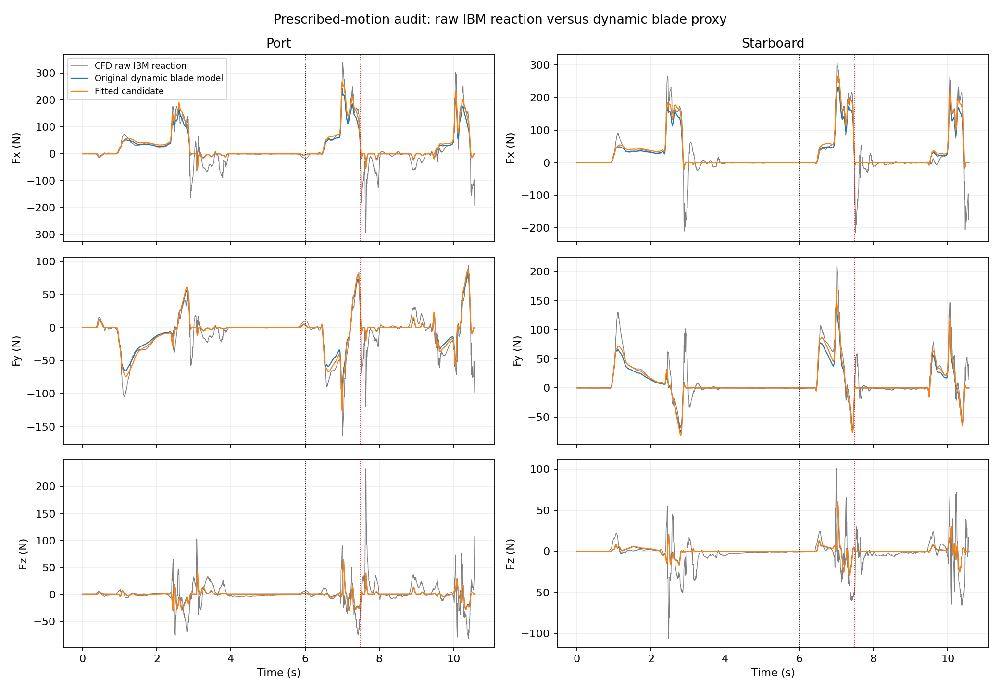

# CFD 固定轨迹校准（2026-11-08）

**源码审计更新：候选不默认启用。原始 CFD 力导出漏计相场重映射动量，规定运动未走内部虚拟流体修正路径。以下拟合改善仅针对不完整观测量，详见 [源码审计](source_audit.md)。**

本次只辨识双桨共享的准定常阻力/升力系数。模型按当前浸水几何、相对速度计算，未引入时间或相位查表；船体、静水浮力、桨叶附加质量及辐射记忆参数不改。

- CDmax: 2 → 2.32444359；CLmax: 0.9 → 1.10424717；摩擦系数仍为 0.01。
- 从原始 ZIP 读取并验证 1077 帧的 SHA256。ALE 反变换后位置最大残差 0.281 mm。
- CFD 是旋转 ALE 基下各组件原点的最后阶段 IBM 反力；两类向量均转至世界轴，基函数力矩也统一到组件原点。
- 轨迹按 CFD 相同线性插值/四元数 nlerp 对齐；使用实际重建输出时刻，存在一个子步量级的评估时刻不确定性。
- 训练：0.5–6 s；连续留出：6–7.44 s；续算点两侧 0.06 s 排除。7.56–10.4 s 仅作数值算法切换后的审计，不参与拟合或选参。
- 采用时间间隔加权的稳健有界拟合，力矩除以固定 2 m 力臂与力共同拟合；阻力倍率范围 [0.25,3]，升力倍率 [0,2]。
- 附加惯性按规定轨迹加速度计算，包括法向旋转与入水质量招募；惯性参数固定为原先验。

| 区间 | 部件 | 力向量 RMSE 原值 → 校准 (N) | 力矩向量 RMSE 原值 → 校准 (N·m) |
|---|---|---:|---:|
| train | port | 29.62 → 29.23 | 56.53 → 55.93 |
| train | starboard | 36.02 → 34.27 | 67.49 → 64.48 |
| validation | port | 37.99 → 31.17 | 69.01 → 56.09 |
| validation | starboard | 38.15 → 31.25 | 68.80 → 55.75 |
| changed_solver_audit | port | 51.78 → 49.64 | 99.80 → 95.70 |
| changed_solver_audit | starboard | 32.12 → 29.29 | 58.69 → 53.28 |

## 可辨识性与适用范围

这些误差比较的是动态桨叶代理模型与原始 IBM 反力，不能解释为对真实总水动力的误差。CFD 整个桨组件含桨杆，模型只显式计算桨叶；附着水、自由面历史与桨杆残差没有通过时序查表强行补偿。
内部虚拟流体保留了与外部相同的初始相分布。聚合 CSV 缺少内部动量变化、重力及应力贡献，无法唯一恢复外部载荷。船体排水体积大，尤其不能用其 raw Fz 替换浮力或据此重标定附加质量。
这条轨迹是外部规定运动，既不是新力模型下的自由航行，也不是独立策略验证；不从位置二阶差分反推机器人总水动力。
惯性倍率从 0 改至 2 的敏感性结果（仅诊断，不写入运行参数）：

| 惯性倍率 | 阻力倍率 | 升力倍率 |
|---:|---:|---:|
| 0.0 | 1.1711 | 0.9489 |
| 0.5 | 1.1685 | 1.0939 |
| 1.0 | 1.1622 | 1.2269 |
| 1.5 | 1.1496 | 1.3431 |
| 2.0 | 1.1317 | 1.4561 |

升力系数与惯性模型明显耦合，因此这是一组有条件的有效参数，不是独立辨识的桨叶极曲线。左右共用系数；左右受力差异由状态产生。
后续应输出经过内部虚拟流体修正的外部力/力矩、明确 RK 受力评估时刻，并增加不同桨频、船速及 feather 的独立规定轨迹，验证后再校准船体和非定常项。

## 使用

重新拟合：`python tools/calibrate_cfd_forces.py --reuse-basis --install-profile`。
训练、微调和回放默认使用原始力律；仅做实验时显式传入 `--force-profile data/cfd_force_calibration.json` 启用候选。
关闭桨叶惯性时自动回到原力律，显式指定有惯性依赖的校准配置会报错。参数只在构造时读取，GPU 回调不读取 CSV、不按相位播放载荷。

图中虚线 6 s 为留出起点，红线 7.5 s 为数值算法切换点。

## 实际执行验证

35 项测试通过（含 5 项新增校准测试）；运行时 Warp 内核与离线湿润裁剪和质心力矩一致。原策略自由回放 8 秒完成，所有数值数组有限，未终止。最大横摇 1.84°。使用 CPU，当前机器没有可用 CUDA 驱动，因此未验证 GPU 执行或吞吐。全套测试和回放通过 TensorBoard 自带的无 TensorFlow 后端绕开本机可选依赖冲突，未修改全局依赖。详见 `verification.json`、`tests.log`、`playback_smoke.log` 和 `free_policy_check/metadata.json`。
